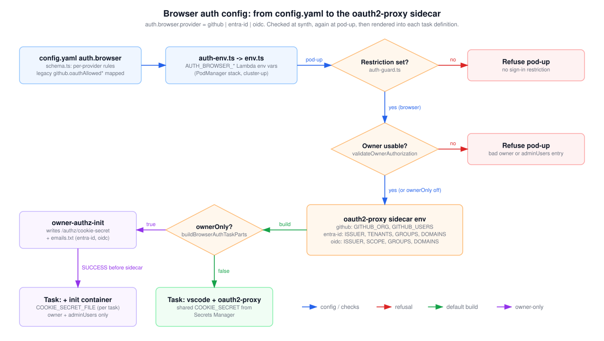

# Browser auth config: from config.yaml to the oauth2-proxy sidecar

This shows how `auth.browser` in `config/config.yaml` becomes the oauth2-proxy sidecar's environment and secrets, and where pod-up refuses to launch. Read it when you're choosing a provider (`github`, `entra-id`, `oidc`) or restrictions, when pod-up fails with "Refusing browser-mode pod-up", or when you want to know what `ownerOnly` changes in the task definition.

## How to read it

- Rounded boxes are steps; orange diamonds are checks.
- Blue arrows carry the config and the checks. Red arrows end in a refusal: pod-up returns an error and creates no AWS resource. Green arrows are the default build. Purple arrows are the `ownerOnly: true` path.
- The per-provider environment is summarized inside the sidecar box; the table below gives each variable.

## Walkthrough

1. **Synth time.** `AuthBrowserSchema` validates `auth.browser` per provider. For `entra-id` and `oidc` it refuses restriction keys the provider ignores (for example `allowedOrg` with `entra-id`, or `allowedTenants` with `oidc`). For `github` there is no such check: `allowedTenants`, `allowedGroups` and `allowedEmailDomains` are accepted and silently ignored. For every provider it refuses the oidc-only keys (`scope`, `groupsClaim`, `insecureAllowUnverifiedEmail`) outside `oidc` and `entraGroupOverage` outside `entra-id`. It also requires an `https://` issuer for `oidc` and a valid Entra issuer for `entra-id`, and requires `allowedTenants` with a multi-tenant Entra issuer. `resolveConfig` maps the deprecated `github.oauthAllowedOrg` / `oauthAllowedUsers` keys when `auth.browser` is absent, and refuses `entra-id` and `oidc` unless `domain.strategy` is `byo`.
2. **Deploy time.** `authLambdaEnvironment` turns the resolved block into `AUTH_BROWSER_*` Lambda variables (lists as JSON arrays). The PodManager stack sets them, so a config change needs `cluster-up` and then a new pod-up. `env.ts` parses them back into `env.auth.browser`.
3. **Restriction guard.** On `pod-up -f mode=browser`, `assertBrowserAuthRestricted` requires at least one restriction that counts for the provider. Without one it refuses, because oauth2-proxy would admit every account the IdP accepts. `allowedEmailDomains` containing `*`, or the personal Microsoft account tenant in `allowedTenants`, does not count.
4. **Owner check.** With `ownerOnly: true`, `validateOwnerAuthorization` requires an owner input that is a GitHub login (`github`) or an email address (`entra-id`, `oidc`). Every `adminUsers` entry must have the same form, and the owner must fall inside `allowedUsers` (github) or `allowedEmailDomains` (oidc, entra-id) when those are set. With `ownerOnly` off this check passes.
5. **Sidecar build.** `registerTaskDef` calls `buildBrowserAuthTaskParts`, which calls `buildOauth2ProxyContainer`. The builder sets the shared settings (listen `0.0.0.0:4180`, upstream `http://127.0.0.1:3000`, `COOKIE_SECURE` on HTTPS) and the provider environment below. It re-checks the issuer rules so a bad Lambda environment can never yield a sidecar that skips them. Client ID, client secret and cookie secret come from Secrets Manager as ECS `secrets`. The sidecar starts only after the vscode container is `HEALTHY`.
6. **ownerOnly false.** The task is `vscode` plus `oauth2-proxy`, and every pod shares `/cloud-dev-pods/oauth/cookie-secret`.
7. **ownerOnly true.** An `owner-authz-init` container (the pod's own runtime image, run as root, non-essential) writes a random 32-hex-character `/authz/cookie-secret` to a task-scoped volume. For `entra-id` and `oidc` it also writes `/authz/emails.txt` with the owner and `adminUsers`. The sidecar mounts the volume read-only and waits for the init container to exit with `SUCCESS`. Its environment is rewritten:
   - All providers: `COOKIE_SECRET_FILE=/authz/cookie-secret` is set and the shared `COOKIE_SECRET` secret is dropped, so a cookie from another pod is not a session here.
   - github: `GITHUB_USERS` becomes owner plus `adminUsers`; `GITHUB_ORG` is removed and `allowedOrg` moves to `ALLOWED_GROUPS` (owner AND org).
   - entra-id, oidc: `AUTHENTICATED_EMAILS_FILE=/authz/emails.txt` is set and `EMAIL_DOMAINS` is removed.

`adminUsers` only has an effect with `ownerOnly: true`, and it is not a restriction for the guard in step 3.

### Provider environment (ownerOnly false)

| Provider | oauth2-proxy variables set from `auth.browser` |
| --- | --- |
| `github` | `EMAIL_DOMAINS=*`, `GITHUB_ORG` from `allowedOrg`, `GITHUB_USERS` from `allowedUsers` (a listed user skips the org check) |
| `entra-id` | `OIDC_ISSUER_URL`, `INSECURE_OIDC_SKIP_ISSUER_VERIFICATION` for multi-tenant issuers, `ENTRA_ID_ALLOWED_TENANTS`, `ALLOWED_GROUPS` (lowercased), `SCOPE` (`+ User.Read` with `entraGroupOverage`), `EMAIL_DOMAINS` from `allowedEmailDomains` or `*` |
| `oidc` | `OIDC_ISSUER_URL` (verbatim), `SCOPE` (default `openid email profile`), `EMAIL_DOMAINS` from `allowedEmailDomains` or `*`, `ALLOWED_GROUPS`, `OIDC_GROUPS_CLAIM`, `INSECURE_OIDC_ALLOW_UNVERIFIED_EMAIL` |

## Elements and sources

| Element | What it is | Source |
| --- | --- | --- |
| config.yaml auth.browser | Schema and per-provider rules | `infra/lib/config/schema.ts:7-50`, `:54-124` |
| (in config box) legacy keys, byo rule | `resolveConfig` mapping and domain checks | `infra/lib/config/schema.ts:234-278` |
| auth-env.ts -> env.ts | `AUTH_BROWSER_*` Lambda env and parsing | `infra/lib/config/auth-env.ts:9-29`, `infra/lib/stacks/pod-manager-stack.ts:100`, `infra/lambda/pod-manager/env.ts:82-98` |
| Restriction set? | Per-provider restriction keys, wildcard and personal-tenant rules | `infra/lambda/pod-manager/auth-guard.ts:25-49` |
| Refuse pod-up (no restriction) | Guard message returned as error | `infra/lambda/pod-manager/auth-guard.ts:60-68`, `infra/lambda/pod-manager/actions.ts:61-65` |
| Owner usable? | Owner and adminUsers form, allowlist fit | `infra/lambda/pod-manager/owner-authz.ts:76-117` |
| Refuse pod-up (bad owner) | Owner check error | `infra/lambda/pod-manager/actions.ts:68-71` |
| oauth2-proxy sidecar env | Shared settings, provider env, secrets, dependsOn | `infra/lambda/pod-manager/oauth2-proxy.ts:46-109`, `:124-158` |
| ownerOnly? | `buildBrowserAuthTaskParts` switch | `infra/lambda/pod-manager/owner-authz.ts:225-255` |
| owner-authz-init | Init container, script, task-scoped volume | `infra/lambda/pod-manager/owner-authz.ts:40-42`, `:137-216` |
| Task: vscode + oauth2-proxy | vscode container plus auth parts | `infra/lambda/pod-manager/aws.ts:317-347` |
| Task: + init container | Rewritten sidecar env, dropped shared secret | `infra/lambda/pod-manager/owner-authz.ts:158-192`, `:240-254` |
| e-cfg-env | Resolved config to Lambda env | `infra/lib/config/auth-env.ts:9-29` |
| e-env-guard | `podUp` runs the guard for browser mode | `infra/lambda/pod-manager/actions.ts:61-62` |
| e-guard-no, e-owner-no | Return `status: 'error'` before any resource | `infra/lambda/pod-manager/actions.ts:63-71` |
| e-guard-yes, e-owner-yes | Continue pod-up | `infra/lambda/pod-manager/actions.ts:72-141` |
| e-sidecar-only | `registerTaskDef` builds auth parts | `infra/lambda/pod-manager/aws.ts:330-347` |
| e-only-no | Returns `[sidecar]` unchanged | `infra/lambda/pod-manager/owner-authz.ts:237` |
| e-only-yes | Builds owner authorization | `infra/lambda/pod-manager/owner-authz.ts:239` |
| e-init-task | Sidecar `dependsOn` init `SUCCESS` | `infra/lambda/pod-manager/owner-authz.ts:191` |

## Related

- [Browser pod request path](browser-request-path.md)
- [OAuth secrets and runtime trust](secrets-and-trust.md)
- [ADR 0008: pluggable browser IdP](../../adr/0008-pluggable-browser-idp.md)
- [Choosing auth and access](../../choosing-auth-and-access.md)
- [Entra ID setup](../../setup-entra.md)

Regenerate: see [../README.md#regenerating](../README.md#regenerating).
