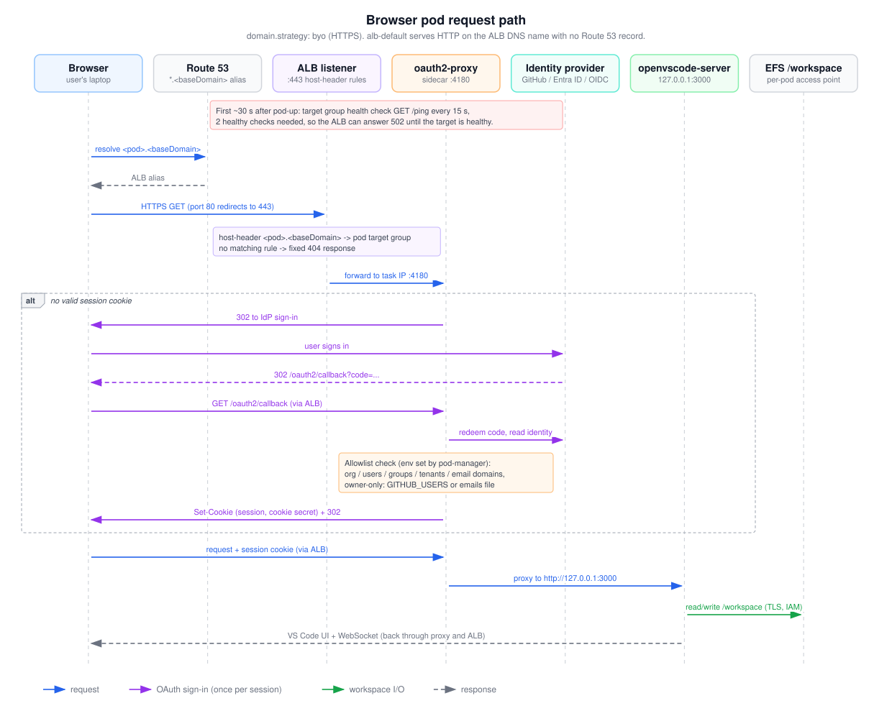

# Browser pod request path

This shows one browser request to a browser-mode pod, from DNS lookup to the VS Code UI. It covers the first visit (with the OAuth sign-in) and later visits that carry a session cookie. Read it when you're debugging a 502, a 404, a sign-in loop or a "403 Forbidden" from oauth2-proxy, or when you want to know where the allowlist is enforced.

## How to read it

- Boxes along the top are participants. Dashed vertical lines are their lifelines, and time runs top to bottom.
- Blue arrows are the request path. Purple arrows are the OAuth sign-in, which only runs inside the `alt` frame (no valid session cookie). The green arrow is workspace file I/O. Gray dashed arrows are responses.
- Tinted notes record a rule at that point: red is the transient 502 window, purple is the ALB rule match, orange is the allowlist check.
- The diagram assumes `domain.strategy: byo`. With `alb-default` there is no Route 53 record or certificate: the browser uses `http://<pod>.<alb-dns-name>` on port 80, and the session cookie is not marked `Secure`.

## Walkthrough

1. The browser resolves `<pod>.<baseDomain>`. Under `byo`, cluster-up creates a wildcard `*` alias record to the ALB and a wildcard ACM certificate ([`cluster-stack.ts`](../../../infra/lib/stacks/cluster-stack.ts)).
2. The browser sends HTTPS to the ALB on 443. Port 80 only redirects to 443.
3. The ALB matches the `host-header` rule that pod-up created for this pod and forwards to the pod's target group. A hostname with no rule gets the listener's fixed 404 "No pod registered for this hostname."
4. The target is the task's private IP on port 4180, which is oauth2-proxy. The tasks security group admits 4180 only from the ALB security group.
5. For about 30 seconds after pod-up, the target isn't healthy yet: the health check hits `/ping` every 15 seconds and needs 2 passes. Until then the ALB can answer 502.
6. With no valid session cookie, oauth2-proxy redirects to the identity provider (`OAUTH2_PROXY_PROVIDER` is `github`, `entra-id` or `oidc`). The user signs in, the IdP redirects back to `/oauth2/callback`, and oauth2-proxy redeems the code.
7. oauth2-proxy then applies the allowlist that pod-manager wrote into its environment (see [browser-auth-providers](browser-auth-providers.md)). The checks run inside oauth2-proxy, not in this repo's code. According to the notes in [`owner-authz.ts`](../../../infra/lambda/pod-manager/owner-authz.ts) (oauth2-proxy v7.15.5), `GITHUB_USERS` and `GITHUB_ORG` are checked only at login, while `ALLOWED_GROUPS` and the authenticated-emails file are checked on every request.
8. On success it sets an encrypted session cookie (shared `/cloud-dev-pods/oauth/cookie-secret`, or a per-task secret when `ownerOnly` is on) and redirects to the original URL.
9. Later requests carry the cookie. oauth2-proxy proxies them to openvscode-server on `http://127.0.0.1:3000` and passes the Authorization header through. openvscode-server listens only on loopback with no connection token, so the sidecar is the only way in.
10. openvscode-server reads and writes `/workspace`, an EFS volume mounted through the pod's own access point with TLS in transit and IAM authorization.
11. The UI and its WebSocket go back through oauth2-proxy and the ALB. The ALB idle timeout is 120 seconds.

## Elements and sources

| Element | What it is | Source |
| --- | --- | --- |
| Browser | The user's browser | `.github/workflows/pod-up.yml:206` (URL in summary) |
| Route 53 | Wildcard alias `*` to the ALB, `byo` only | `infra/lib/stacks/cluster-stack.ts:155` |
| ALB listener | HTTPS :443 listener, wildcard cert, default fixed 404 | `infra/lib/stacks/cluster-stack.ts:114`, `:131`, `:146` |
| oauth2-proxy | Sidecar container on :4180, upstream 127.0.0.1:3000 | `infra/lambda/pod-manager/oauth2-proxy.ts:124-158` |
| Identity provider | `OAUTH2_PROXY_PROVIDER` = github / entra-id / oidc | `infra/lambda/pod-manager/oauth2-proxy.ts:144` |
| openvscode-server | IDE bound to 127.0.0.1:3000, no connection token | `runtime/vscode-browser/entrypoint.sh:5-8` |
| EFS /workspace | Per-pod access point, TLS, IAM | `infra/lambda/pod-manager/aws.ts:398-405` |
| Note: 502 window | Health check `/ping`, 15 s interval, 2 healthy | `infra/lambda/pod-manager/aws.ts:500-505`, `docs/troubleshooting.md:144-146` |
| Note: host rule | `host-header` condition, forward to pod target group | `infra/lambda/pod-manager/aws.ts:527-531`, `infra/lambda/pod-manager/actions.ts:145-146` |
| Note: allowlist check | Provider env written by pod-manager; owner-only overrides | `infra/lambda/pod-manager/oauth2-proxy.ts:46-106`, `infra/lambda/pod-manager/owner-authz.ts:6-19` |
| m-dns, m-dns-r | DNS lookup of `<pod>.<baseDomain>` | `infra/lib/stacks/cluster-stack.ts:155-159` |
| m-https | HTTPS to 443; port 80 redirects | `infra/lib/stacks/cluster-stack.ts:136-144` |
| m-fwd | Target group: HTTP to task IP, port 4180 | `infra/lambda/pod-manager/aws.ts:493-499`, `:552-556`; `infra/lib/stacks/network-stack.ts:87` |
| m-redirect, m-signin, m-callback, m-cb-proxy, m-token | oauth2-proxy OAuth flow; callback path `/oauth2/callback` | `.github/workflows/pod-up.yml:207` |
| m-cookie | Session cookie; `COOKIE_SECURE` true on HTTPS | `infra/lambda/pod-manager/oauth2-proxy.ts:149`, `:155` |
| frame-login (`alt`) | Sign-in only without a valid session | `infra/lambda/pod-manager/owner-authz.ts:6-14` |
| m-req | Request with cookie | `infra/lambda/pod-manager/oauth2-proxy.ts:145-147` |
| m-up | Proxy to upstream, Authorization header passed | `infra/lambda/pod-manager/oauth2-proxy.ts:146-148` |
| m-efs | `/workspace` mount on the vscode container | `infra/lambda/pod-manager/aws.ts:323` |
| m-ui | Response path; ALB idle timeout 120 s | `infra/lib/stacks/cluster-stack.ts:106-111` |

## Related

- [Browser auth config](browser-auth-providers.md)
- [OAuth secrets and runtime trust](secrets-and-trust.md)
- [Tunnel device-code sign-in](tunnel-device-code-flow.md)
- [ADR 0002: oauth2-proxy sidecar](../../adr/0002-oauth2-proxy-sidecar.md)
- [ADR 0005: host-based ALB routing](../../adr/0005-host-based-alb-routing.md)
- [Troubleshooting](../../troubleshooting.md)

Regenerate: see [../README.md#regenerating](../README.md#regenerating).
