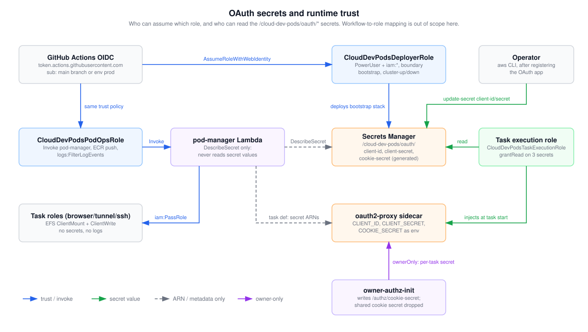

# OAuth secrets and runtime trust

This shows where the browser OAuth secrets live and which principal can touch them: the GitHub OIDC roles, the pod-manager Lambda, the task execution role and the task roles. Read it before changing IAM, rotating a secret, or adding a provider. The mapping of each workflow to a role belongs to the operations diagrams and isn't repeated here.

## How to read it

- Boxes are principals or resources. Blue arrows are trust and invoke rights. Green arrows carry a secret value. Gray dashed arrows carry only an ARN or metadata, never the value. The purple arrow is the `ownerOnly` per-task cookie secret.

## Walkthrough

1. **GitHub OIDC trust.** The bootstrap stack creates an OIDC provider for `token.actions.githubusercontent.com`. `CloudDevPodsDeployerRole` and `CloudDevPodsPodOpsRole` share one trust condition: audience `sts.amazonaws.com` and a `sub` of `repo:<org>/<repo>:ref:refs/heads/main` or `repo:<org>/<repo>:environment:prod`. Both have the `CloudDevPodsBoundary` permissions boundary (ADR 0003).
2. **Deployer.** PowerUserAccess plus `iam:*` within the boundary. It deploys the stacks, including the bootstrap stack that owns the three secrets (on later `bootstrap-aws.yml` runs; the first run uses temporary bootstrap keys). The secrets have `RemovalPolicy.RETAIN`.
3. **Secrets Manager.** `/cloud-dev-pods/oauth/client-id` and `client-secret` start as placeholders. The operator sets them with `aws secretsmanager update-secret` after registering the OAuth app with the identity provider. `cookie-secret` is generated as 32 characters (oauth2-proxy needs 16, 24 or 32 bytes). None rotate automatically.
4. **PodOps.** Can invoke `pod-manager`, push to the project ECR repos, and read the `/cloud-dev-pods/*` log groups (used for the tunnel device code). It has no Secrets Manager rights.
5. **pod-manager Lambda.** Holds `secretsmanager:DescribeSecret` on `/cloud-dev-pods/oauth/*` only. It resolves each secret's full ARN (the random suffix) and puts the ARNs in the task definition's `secrets`. It never reads a value. It may `iam:PassRole` the task and execution roles, only to `ecs-tasks.amazonaws.com`.
6. **Task execution role.** `CloudDevPodsTaskExecutionRole` has `grantRead` on the three secrets. When a browser task starts, ECS reads them with this role and injects `OAUTH2_PROXY_CLIENT_ID`, `OAUTH2_PROXY_CLIENT_SECRET` and `OAUTH2_PROXY_COOKIE_SECRET` into the sidecar. The tunnel task uses the same execution role but declares no secrets. ssh pods get a separate execution role with no secret grant.
7. **Task roles.** One per mode (browser, tunnel, ssh). Each allows only EFS `ClientMount` and `ClientWrite` through a mount target and an access point. No secrets, and no CloudWatch Logs, so code in a pod can't read the OAuth secrets through AWS APIs or forge log lines.
8. **ownerOnly.** The `owner-authz-init` container writes a random per-task cookie secret to `/authz/cookie-secret` on a task-scoped volume, and the sidecar uses `COOKIE_SECRET_FILE` instead. The shared cookie secret is removed from the sidecar's `secrets`, so a session cookie from one pod doesn't decrypt on another. The vscode container doesn't mount that volume.

## Elements and sources

| Element | What it is | Source |
| --- | --- | --- |
| GitHub Actions OIDC | OIDC provider and `sub` / `aud` conditions | `infra/lib/stacks/bootstrap-stack.ts:35-36`, `:83-95` |
| CloudDevPodsDeployerRole | PowerUser + `iam:*`, boundary | `infra/lib/stacks/bootstrap-stack.ts:98-118` |
| CloudDevPodsPodOpsRole | Invoke, ECR push, logs read | `infra/lib/stacks/bootstrap-stack.ts:122-169` |
| Operator | Sets client ID and secret after app registration | `infra/lib/stacks/bootstrap-stack.ts:186-200` |
| Secrets Manager | Three secrets, retained, generated cookie secret | `infra/lib/stacks/bootstrap-stack.ts:193-213` |
| pod-manager Lambda | `DescribeSecret` only; ARN lookup | `infra/lib/stacks/pod-manager-stack.ts:238-243`, `infra/lambda/pod-manager/aws.ts:64-71` |
| Task execution role | `grantRead` on the three secrets | `infra/lib/stacks/pod-task-family-stack.ts:72-85` |
| Task roles | EFS mount/write only, no logs | `infra/lib/stacks/pod-task-family-stack.ts:86-130` |
| oauth2-proxy sidecar | `secrets` with `valueFrom` ARNs | `infra/lambda/pod-manager/oauth2-proxy.ts:152-156` |
| owner-authz-init | Per-task cookie secret, shared secret removed | `infra/lambda/pod-manager/owner-authz.ts:15-19`, `:40-41`, `:183-195` |
| e-oidc-deployer, e-oidc-podops | Both roles assumed by the same principal | `infra/lib/stacks/bootstrap-stack.ts:88-101`, `:122-125` |
| e-deployer-secrets | Bootstrap stack owns the secrets | `infra/lib/stacks/bootstrap-stack.ts:185-213` |
| e-operator-secrets | `update-secret` for client ID and secret | `infra/lib/stacks/bootstrap-stack.ts:195`, `:200` |
| e-podops-lambda | `lambda:InvokeFunction` on `pod-manager` | `infra/lib/stacks/bootstrap-stack.ts:129-136` |
| e-lambda-secrets | `DescribeSecret` | `infra/lambda/pod-manager/aws.ts:67`, `:334-336` |
| e-exec-secrets | Read via `grantRead` | `infra/lib/stacks/pod-task-family-stack.ts:83-85` |
| e-lambda-taskroles | `iam:PassRole`, `ecs-tasks` only | `infra/lib/stacks/pod-manager-stack.ts:215-228` |
| e-lambda-sidecar | Task definition with secret ARNs | `infra/lambda/pod-manager/aws.ts:330-347` |
| e-exec-sidecar | ECS injects secrets as env at start | `infra/lambda/pod-manager/oauth2-proxy.ts:152-156`, `infra/lambda/pod-manager/aws.ts:304` |
| e-init-sidecar | `COOKIE_SECRET_FILE`, drop `COOKIE_SECRET` | `infra/lambda/pod-manager/owner-authz.ts:183-191` |
| ssh execution role (text only) | No secret grant | `infra/lib/stacks/pod-task-family-stack.ts:230-238` |

## Related

- [Browser auth config](browser-auth-providers.md)
- [Browser pod request path](browser-request-path.md)
- [Tunnel device-code sign-in](tunnel-device-code-flow.md)
- [ADR 0003: pod-manager Lambda](../../adr/0003-pod-manager-lambda.md)
- [ADR 0002: oauth2-proxy sidecar](../../adr/0002-oauth2-proxy-sidecar.md)

Regenerate: see [../README.md#regenerating](../README.md#regenerating).
