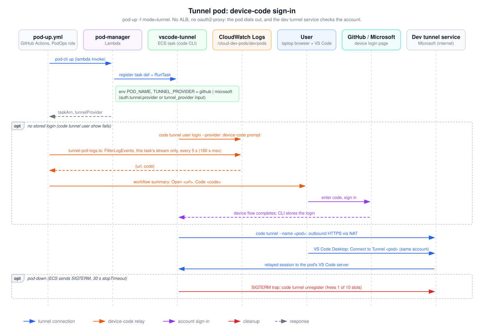

# Tunnel pod: device-code sign-in

This shows how a tunnel pod gets from `pod-up -f mode=tunnel` to a VS Code Desktop session. The pod has no ALB route and no oauth2-proxy: the VS Code CLI in the task signs in with a device code and dials out to Microsoft's dev tunnel service, which only lets the same account connect. Read it when the device code doesn't appear in the workflow summary or the tunnel doesn't show up in VS Code Desktop.

## How to read it

- Boxes along the top are participants; time runs top to bottom.
- Orange arrows relay the device code from the task to the user through CloudWatch Logs and the workflow. Purple arrows are the account sign-in. Blue arrows are the tunnel itself. The red arrow is cleanup on pod-down. Gray dashed arrows are responses.
- The first `opt` frame runs only when the CLI has no stored login. The second runs on pod-down.

## Walkthrough

1. `pod-up.yml` assumes the PodOps role through GitHub OIDC and runs `scripts/pod-cli.ts up`, which invokes the `pod-manager` Lambda.
2. pod-manager registers a task definition with one `vscode-tunnel` container (EFS `/workspace`, no port mappings) and runs it in a private subnet with no public IP. It passes `POD_NAME` and `TUNNEL_PROVIDER`, taken from the `tunnel_provider` input or `auth.tunnel.provider` (`github` by default, or `microsoft`). If the owner already has 10 tunnel pods, the result carries a warning.
3. pod-manager returns `taskArn` and `tunnelProvider` to the workflow.
4. In the task, `entrypoint.sh` runs `code tunnel user show`. If no login is stored, it runs `code tunnel user login --provider $TUNNEL_PROVIDER`, which prints a device-code prompt. The awslogs driver writes it to `/cloud-dev-pods/dev/pods`, stream `tunnel/<pod>/vscode-tunnel/vscode-tunnel/<taskId>`.
5. The workflow runs `scripts/tunnel-poll-logs.ts`, which calls `FilterLogEvents` on that task's stream only, every 5 seconds for up to 180 seconds. It never matches on a stream prefix: another stream under `tunnel/<pod>/` isn't proof this task wrote it. Task roles have no CloudWatch Logs rights, so a pod can't forge another pod's prompt.
6. The poller extracts the URL (`github.com/login/device`, `login.microsoft.com/device` or `microsoft.com/devicelogin`) and the code. The workflow prints them in the run summary, or tells the user to tail the logs if nothing was found.
7. The user opens the URL, enters the code and signs in with the account type shown. The CLI's device flow completes and the login is stored in the container.
8. The entrypoint runs `code tunnel --accept-server-license-terms --name <pod>`, which registers the tunnel with the dev tunnel service over outbound HTTPS (through the NAT gateway).
9. On the laptop, VS Code Desktop signed in with the same account runs `Remote Tunnels: Connect to Tunnel` and picks `<pod>`. The service relays the session to the VS Code server in the pod.
10. On pod-down, ECS sends SIGTERM. The trap stops the tunnel, then runs `code tunnel unregister` (bounded to fit the 30-second `stopTimeout`), which frees one of the account's 10 tunnel slots.

The same tunnel image also has an `ssh` mode (sshd on port 2222, `POD_MODE=ssh`) with its own task family and execution role. It isn't drawn: `pod-up.yml` hides `ssh` from its mode options (#228), and pod-up refuses it unless `remote.backend` is set, which no backend supports yet.

## Elements and sources

| Element | What it is | Source |
| --- | --- | --- |
| pod-up.yml | Workflow, PodOps role via OIDC | `.github/workflows/pod-up.yml:98-102` |
| pod-manager | Lambda `podUp` | `infra/lambda/pod-manager/actions.ts:30-211` |
| vscode-tunnel | ECS task running the VS Code CLI | `infra/lambda/pod-manager/aws.ts:373-387`, `runtime/vscode-tunnel/entrypoint.sh:107-157` |
| CloudWatch Logs | Pods log group, per-task stream | `infra/lambda/pod-manager/aws.ts:308-315`, `scripts/tunnel-poll-logs.ts:49-58` |
| User | Laptop browser and VS Code Desktop | `.github/workflows/pod-up.yml:220-225` |
| GitHub / Microsoft | Device login pages | `scripts/tunnel-poll-logs.ts:65-73` |
| Dev tunnel service | Microsoft dev tunnels (10 per account) | `infra/lambda/pod-manager/actions.ts:240-244` |
| Note: env | `POD_NAME`, `TUNNEL_PROVIDER` | `infra/lambda/pod-manager/aws.ts:382-385`, `infra/lambda/pod-manager/actions.ts:88` |
| m-invoke | `InvokeCommand` on `pod-manager` | `scripts/pod-cli.ts:105-125`, `.github/workflows/pod-up.yml:126-133` |
| m-run | RegisterTaskDefinition + RunTask, no public IP | `infra/lambda/pod-manager/aws.ts:389-411`, `:416-442` |
| m-result | `taskArn`, `tunnelProvider`, cap `warning` | `infra/lambda/pod-manager/actions.ts:177-193`, `:246-260` |
| frame-login (`opt`) | `code tunnel user show` fails | `runtime/vscode-tunnel/entrypoint.sh:121-123` |
| m-login | Device-code prompt to stdout, awslogs | `runtime/vscode-tunnel/entrypoint.sh:122`, `infra/lambda/pod-manager/aws.ts:379` |
| m-poll | `FilterLogEvents`, one stream, 5 s loop | `scripts/tunnel-poll-logs.ts:94-117`, `.github/workflows/pod-up.yml:176-180` |
| m-code | `{url, code}` JSON | `scripts/tunnel-poll-logs.ts:79-84`, `:105` |
| m-summary | Run summary with URL and code | `.github/workflows/pod-up.yml:218-231` |
| m-signin, m-token | Device flow sign-in | `runtime/vscode-tunnel/entrypoint.sh:118-123` |
| m-register | `code tunnel --name <pod>` | `runtime/vscode-tunnel/entrypoint.sh:153` |
| m-connect | `Remote Tunnels: Connect to Tunnel` | `.github/workflows/pod-up.yml:225` |
| m-relay | Session relayed to the pod | `runtime/vscode-tunnel/entrypoint.sh:153-157` |
| frame-down, m-unreg | SIGTERM trap, `code tunnel unregister` | `runtime/vscode-tunnel/entrypoint.sh:125-151`, `infra/lambda/pod-manager/aws.ts:380-381` |
| PodOps logs read | `logs:FilterLogEvents` on `/cloud-dev-pods/*` | `infra/lib/stacks/bootstrap-stack.ts:161-168` |
| No logs on task roles | Task roles are EFS-only | `infra/lib/stacks/pod-task-family-stack.ts:87-90` |

## Related

- [OAuth secrets and runtime trust](secrets-and-trust.md)
- [Browser pod request path](browser-request-path.md)
- [Delivery modes](../../delivery-modes.md)
- [Choosing auth and access](../../choosing-auth-and-access.md)

Regenerate: see [../README.md#regenerating](../README.md#regenerating).
