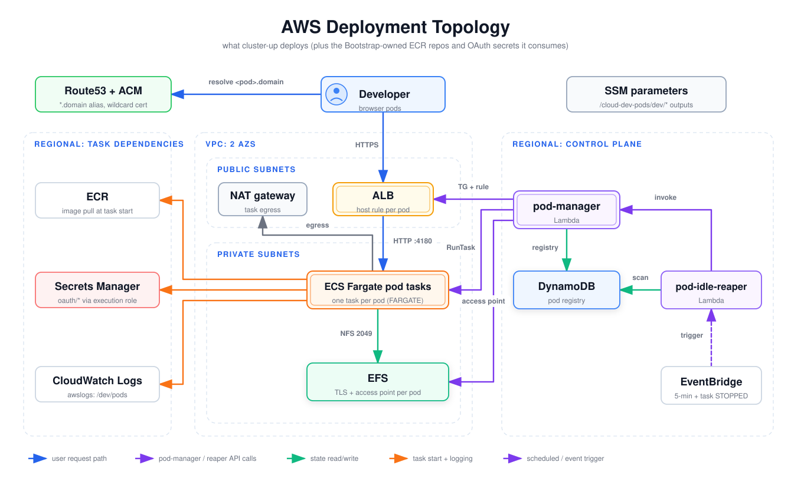

# AWS Deployment Topology

The AWS resources `cluster-up` deploys and how they connect at runtime: the VPC with its public and private subnets, the internet-facing ALB, the Fargate pod tasks, EFS, and the two Lambdas outside the VPC that manage pods. The diagram also includes the ECR repositories and OAuth secrets. The Bootstrap stack owns those, but every pod task consumes them. Read it to find out where a resource lives, what reaches it, and what to look at when a pod cannot start or cannot be reached.

## How to read it

- **Dashed containers** group resources. "VPC: 2 AZs" holds the public and private subnets. The two "Regional" groups hold services that are not in the VPC. The Lambdas have no VPC config.
- **Blue**: the developer's request path (DNS lookup, HTTPS to the ALB, ALB to the pod on port 4180).
- **Purple solid**: API calls made by `pod-manager` or `pod-idle-reaper`.
- **Green**: state reads and writes (EFS over NFS, the DynamoDB registry).
- **Orange**: what a task needs at start and while running (image pull, OAuth secrets, logs). The task's execution role makes these calls.
- **Purple dashed**: EventBridge triggers.
- **Gray** ("egress"): task egress through the NAT gateway.
- SSM parameters has no edges. Every stack writes its outputs there, and workflows read them, but nothing in the runtime path reads them.

## Walkthrough

1. **DNS and certificate (byo domain only).** With `domain.strategy: byo` the Cluster stack issues a wildcard ACM certificate for `*.<baseDomain>` and creates a wildcard Route53 alias to the ALB. With `alb-default` there is no certificate or alias, and the listener is HTTP on port 80 ([`cluster-stack.ts`](../../../infra/lib/stacks/cluster-stack.ts)).
2. **ALB.** The ALB is internet-facing and sits in the public subnets behind `sg-alb` (80/443 from anywhere). Its listener's default action returns 404. `pod-manager` adds one target group and one `host-header` listener rule per browser pod ([`aws.ts`](../../../infra/lambda/pod-manager/aws.ts)).
3. **Pod tasks.** `pod-manager` starts one Fargate task per pod in the private subnets, with `sg-tasks` and no public IP. The ALB reaches the oauth2-proxy sidecar on port 4180. `sg-tasks` admits 4180 from `sg-alb` only ([`network-stack.ts`](../../../infra/lib/stacks/network-stack.ts)). The cluster enables both the FARGATE and FARGATE_SPOT capacity providers, but `RunTask` currently passes `launchType: 'FARGATE'`. `pods.spotPercentage` is in the config schema, but nothing reads it yet.
4. **Egress.** Tasks reach the internet (the IdP, the VS Code tunnel service, and AWS APIs) through the NAT gateway (`network.natGateways`, default 1). When `network.useVpcEndpoints` is true, interface endpoints for ECR, Secrets Manager and CloudWatch Logs are added. An S3 gateway endpoint is always created.
5. **Task dependencies.** At task start the shared execution role pulls the image from ECR (`cloud-dev-pods/vscode-browser` or `-tunnel`) and reads the `/cloud-dev-pods/oauth/*` secrets. Containers log to `/cloud-dev-pods/<env>/pods` through the `awslogs` driver. The task definition that actually runs is the per-pod revision `pod-manager` registers at pod-up ([`aws.ts`](../../../infra/lambda/pod-manager/aws.ts)). The CDK task definitions in [`pod-task-family-stack.ts`](../../../infra/lib/stacks/pod-task-family-stack.ts) are placeholders. On every pod-up, `pod-manager` itself also calls ECR `DescribeImages` to find the latest image tag and Secrets Manager `DescribeSecret` to resolve the OAuth secret ARNs (`infra/lambda/pod-manager/aws.ts:146`, `infra/lambda/pod-manager/aws.ts:334`, `infra/lib/stacks/pod-manager-stack.ts:201-245`). Those calls are not drawn.
6. **EFS.** EFS is one encrypted file system in the private subnets behind `sg-efs` (2049 from `sg-tasks` only). Its file-system policy denies any mount that skips TLS or an access point. `pod-manager` creates one access point per pod (ADR 0004). The removal policy follows `efs.retainOnClusterDown` (ADR 0007).
7. **pod-manager Lambda.** GitHub Actions invokes it through the pod-ops role. It registers task-definition revisions, runs and stops tasks, creates ALB target groups and rules, creates and deletes EFS access points, and records each pod in the `cloud-dev-pods-registry` DynamoDB table ([`pod-manager-stack.ts`](../../../infra/lib/stacks/pod-manager-stack.ts)).
8. **pod-idle-reaper Lambda.** Two EventBridge rules trigger it: every 5 minutes, and on ECS task `STOPPED` events in the cluster. It scans the registry, checks ALB `RequestCount` in CloudWatch, publishes warnings to an SNS topic, and invokes `pod-manager` to stop idle pods or clean up stopped ones ([`idle-reaper-stack.ts`](../../../infra/lib/stacks/idle-reaper-stack.ts), [`handler.ts`](../../../infra/lambda/idle-reaper/handler.ts)).

## Elements and sources

| Element | What it is | Source |
| --- | --- | --- |
| Route53 + ACM | Wildcard cert and wildcard alias to the ALB (`byo` only) | `infra/lib/stacks/cluster-stack.ts:131`, `infra/lib/stacks/cluster-stack.ts:155` |
| Developer | Browser-pod user | `infra/lib/stacks/cluster-stack.ts:146` |
| SSM parameters | Stack outputs under `/<project>/<env>/...`, read by workflows | `infra/lib/util/naming.ts:7`, `.github/workflows/cluster-up.yml:113` |
| VPC: 2 AZs | VPC with `maxAzs: 2`, public /24 and private /22 subnets, S3 gateway endpoint, REJECT flow logs | `infra/lib/stacks/network-stack.ts:40` |
| NAT gateway | Count from `network.natGateways` | `infra/lib/stacks/network-stack.ts:43` |
| ALB | Internet-facing, `sg-alb`, default 404 | `infra/lib/stacks/cluster-stack.ts:106`, `infra/lib/stacks/cluster-stack.ts:114` |
| ECS Fargate pod tasks | Cluster with Fargate capacity providers; `RunTask` uses `launchType: 'FARGATE'` in private subnets | `infra/lib/stacks/cluster-stack.ts:46`, `infra/lambda/pod-manager/aws.ts:416` |
| EFS | Encrypted, TLS plus access-point policy, removal policy from config | `infra/lib/stacks/cluster-stack.ts:73`, `infra/lib/stacks/cluster-stack.ts:91` |
| ECR | `cloud-dev-pods/vscode-browser` and `vscode-tunnel` repos (Bootstrap stack) | `infra/lib/stacks/bootstrap-stack.ts:171`, `infra/lib/stacks/bootstrap-stack.ts:178` |
| Secrets Manager | `/cloud-dev-pods/oauth/{client-id,client-secret,cookie-secret}` (Bootstrap stack) | `infra/lib/stacks/bootstrap-stack.ts:193` |
| CloudWatch Logs | Pods log group `/cloud-dev-pods/<env>/pods` | `infra/lib/stacks/cluster-stack.ts:175` |
| pod-manager | Node 24 arm64 Lambda, not in the VPC | `infra/lib/stacks/pod-manager-stack.ts:52` |
| DynamoDB | `cloud-dev-pods-registry`, keyed by `podName` | `infra/lib/stacks/pod-manager-stack.ts:40` |
| pod-idle-reaper | Node 24 arm64 Lambda, not in the VPC | `infra/lib/stacks/idle-reaper-stack.ts:44` |
| EventBridge | 5-minute schedule and ECS task `STOPPED` rule | `infra/lib/stacks/idle-reaper-stack.ts:86`, `infra/lib/stacks/idle-reaper-stack.ts:93` |
| Edge: resolve `<pod>.domain` | Wildcard alias record | `infra/lib/stacks/cluster-stack.ts:155` |
| Edge: HTTPS | HTTPS listener (`byo`), HTTP-to-HTTPS redirect on 80 | `infra/lib/stacks/cluster-stack.ts:136`, `infra/lib/stacks/cluster-stack.ts:146` |
| Edge: HTTP :4180 | Target group port 4180; `sg-tasks` allows 4180 from `sg-alb` | `infra/lambda/pod-manager/aws.ts:497`, `infra/lib/stacks/network-stack.ts:87` |
| Edge: egress | Private subnets are `PRIVATE_WITH_EGRESS` via NAT; `assignPublicIp: 'DISABLED'` | `infra/lib/stacks/network-stack.ts:46`, `infra/lambda/pod-manager/aws.ts:425` |
| Edge: NFS 2049 | `sg-efs` allows 2049 from `sg-tasks`; the per-pod task revision mounts EFS with transit encryption and the pod's access point | `infra/lib/stacks/network-stack.ts:94`, `infra/lambda/pod-manager/aws.ts:398-404` (CDK placeholder: `infra/lib/stacks/pod-task-family-stack.ts:147`) |
| Edge: Fargate to ECR | Image pull by the execution role | `infra/lib/stacks/pod-task-family-stack.ts:74` |
| Edge: Fargate to Secrets Manager | Execution role granted read on the OAuth secrets | `infra/lib/stacks/pod-task-family-stack.ts:83` |
| Edge: Fargate to CloudWatch Logs | `awslogs` driver to the pods log group, set on the per-pod task revision | `infra/lambda/pod-manager/aws.ts:308-315` (CDK placeholder: `infra/lib/stacks/pod-task-family-stack.ts:176`) |
| Edge: TG + rule | ELB create/delete rule and target-group rights; `host-header` rule | `infra/lib/stacks/pod-manager-stack.ts:148`, `infra/lambda/pod-manager/aws.ts:530` |
| Edge: RunTask | ECS task lifecycle rights pinned to the cluster | `infra/lib/stacks/pod-manager-stack.ts:138`, `infra/lambda/pod-manager/aws.ts:416` |
| Edge: access point | `CreateAccessPoint` on the file system; tagged delete | `infra/lib/stacks/pod-manager-stack.ts:167`, `infra/lambda/pod-manager/aws.ts:169` |
| Edge: registry | Read/write grant; `registryPut` | `infra/lib/stacks/pod-manager-stack.ts:105`, `infra/lambda/pod-manager/aws.ts:104` |
| Edge: invoke | Reaper granted invoke on pod-manager | `infra/lib/stacks/idle-reaper-stack.ts:76`, `infra/lambda/idle-reaper/handler.ts:133` |
| Edge: scan | Reaper read/write on the registry | `infra/lib/stacks/idle-reaper-stack.ts:75`, `infra/lambda/idle-reaper/handler.ts:59` |
| Edge: trigger | Both rules target the reaper | `infra/lib/stacks/idle-reaper-stack.ts:89`, `infra/lib/stacks/idle-reaper-stack.ts:103` |

Not drawn, to keep the diagram readable: the `cloud-dev-pods-idle-warnings` SNS topic (`infra/lib/stacks/idle-reaper-stack.ts:38`), the reaper's CloudWatch metrics query, the Lambda and cluster log groups, the optional interface endpoints (`infra/lib/stacks/network-stack.ts:59`), the HTTP-to-HTTPS redirect listener, and the SSH task family (defined at `infra/lib/stacks/pod-task-family-stack.ts:243` but not offered by `pod-up`).

## Related

- [System context](../system/system-context.md)
- [CDK stack composition](cdk-stack-composition.md)
- [ADR 0003: pod-manager Lambda](../../adr/0003-pod-manager-lambda.md)
- [ADR 0004: EFS access point per pod](../../adr/0004-efs-per-pod-access-point.md)
- [ADR 0005: host-based ALB routing](../../adr/0005-host-based-alb-routing.md)
- [ADR 0007: EFS cluster removal policy](../../adr/0007-efs-cluster-removal-policy.md)
- [Cost controls](../../cost-controls.md)

Regenerate: see [../README.md#regenerating](../README.md#regenerating).
