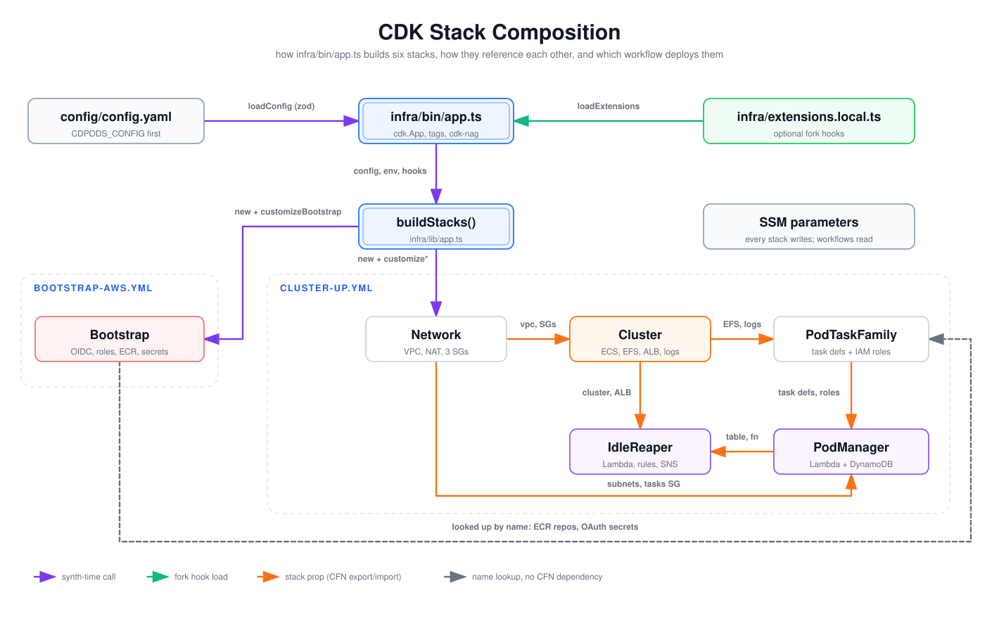

# CDK Stack Composition

How the CDK app is put together: where config and fork hooks are loaded, how `buildStacks()` creates the six stacks, which stack passes resources to which, and which workflow deploys each group. Read it before changing a stack, adding an `infra/extensions.local.ts` hook, or debugging a `cdk deploy` ordering or export error.

## How to read it

- **Purple**: synth-time calls in the CDK app (load config, call `buildStacks`, construct each stack and run its hook).
- **Green**: loading the optional fork hooks file.
- **Orange**: a stack passing a construct to another stack as a constructor prop. CDK turns these into CloudFormation exports and imports, so the consuming stack depends on the producing one, and `cdk deploy` orders them.
- **Gray dashed**: a lookup by fixed name (`fromRepositoryName`, `fromSecretNameV2`). This creates no CloudFormation dependency, so Bootstrap must already be deployed.
- **Containers** name the workflow that deploys the stacks inside them. `cluster-down.yml` destroys the same five stacks that `cluster-up.yml` deploys.

## Walkthrough

1. **Config.** [`loadConfig()`](../../../infra/lib/config/config.ts) reads `CDPODS_CONFIG` if set (CI sets it). Otherwise it falls back to `config/config.yaml`, then `config/config.example.yaml`. It validates the file with the zod schema in [`schema.ts`](../../../infra/lib/config/schema.ts) and prints deprecation warnings. [`auth-env.ts`](../../../infra/lib/config/auth-env.ts) later turns the resolved `auth` block into pod-manager environment variables.
2. **Entry point.** [`infra/bin/app.ts`](../../../infra/bin/app.ts) creates the `cdk.App` and sets `env` from `CDK_DEFAULT_*`, falling back to `config.aws.region`. It calls `buildStacks` with the loaded hooks, then applies project tags and the cdk-nag `AwsSolutionsChecks` plugin.
3. **Fork hooks.** [`loadExtensions()`](../../../infra/lib/extensions.ts) loads `infra/extensions.local.ts` if the file exists. It checks that the file exports `extensions` and that every key is a known hook. Forks commit this file so `cluster-up` applies it ([`extending.md`](../../extending.md)).
4. **`buildStacks()`.** [`infra/lib/app.ts`](../../../infra/lib/app.ts) names every stack `${naming.prefix}-<Suffix>` ([`stack-names.ts`](../../../infra/lib/stack-names.ts)). It constructs Bootstrap, Network, Cluster, PodTaskFamily, PodManager and IdleReaper in that order. Right after each stack is constructed, it calls that stack's hook (`customizeBootstrap` through `customizeIdleReaper`), so a later hook sees what an earlier one added.
5. **Cross-stack props.** Network passes the VPC and security groups to Cluster. Cluster passes only the EFS file system and the pods log group to PodTaskFamily. PodTaskFamily passes task definitions and IAM roles to PodManager. PodManager passes the registry table and function to IdleReaper. PodManager also takes `network` (subnets, tasks SG) and `cluster` (ECS cluster, EFS, ALB listener, pods log group). IdleReaper also takes `cluster` (cluster ARN, ALB name).
6. **Bootstrap lookups.** PodTaskFamily imports the ECR repositories and OAuth secrets by name. They are owned by Bootstrap, which `cluster-up` never deploys.
7. **Deployment.** [`bootstrap-aws.yml`](../../../.github/workflows/bootstrap-aws.yml) deploys only the Bootstrap stack, with the static bootstrap keys. [`cluster-up.yml`](../../../.github/workflows/cluster-up.yml) deploys the other five with the deployer role (`cdk deploy ... --concurrency 4`). Both get stack names from [`scripts/stack-names.ts`](../../../scripts/stack-names.ts). Every stack also writes its outputs to SSM under `/<project>/<env>/...`. Workflows read those values, for example `cluster-up` reading the ALB DNS name and the pod-manager ARN. Stacks pass values to each other through props, not SSM.

## Elements and sources

| Element | What it is | Source |
| --- | --- | --- |
| config/config.yaml | Committed fork config; resolved via `CDPODS_CONFIG`, then defaults | `infra/lib/config/config.ts:21`, `infra/lib/config/config.ts:30` |
| infra/bin/app.ts | CDK entry point: App, env, tags, cdk-nag | `infra/bin/app.ts:10`, `infra/bin/app.ts:27`, `infra/bin/app.ts:31` |
| infra/extensions.local.ts | Optional fork hooks file | `infra/lib/extensions.ts:49` |
| buildStacks() | Constructs all six stacks and runs hooks | `infra/lib/app.ts:21` |
| SSM parameters | `ssmParamPath` outputs; read by workflows | `infra/lib/util/naming.ts:7`, `.github/workflows/cluster-up.yml:113` |
| Bootstrap | OIDC provider, deployer and pod-ops roles, ECR repos, OAuth secrets | `infra/lib/stacks/bootstrap-stack.ts:35`, `infra/lib/stacks/bootstrap-stack.ts:98`, `infra/lib/stacks/bootstrap-stack.ts:171`, `infra/lib/stacks/bootstrap-stack.ts:193` |
| Network | VPC, NAT, three SGs | `infra/lib/stacks/network-stack.ts:22` |
| Cluster | ECS cluster, EFS, ALB, listener, log groups | `infra/lib/stacks/cluster-stack.ts:29` |
| PodTaskFamily | Browser, tunnel and ssh task definitions plus roles | `infra/lib/stacks/pod-task-family-stack.ts:28` |
| PodManager | Registry table and pod-manager Lambda | `infra/lib/stacks/pod-manager-stack.ts:40`, `infra/lib/stacks/pod-manager-stack.ts:52` |
| IdleReaper | Reaper Lambda, EventBridge rules, SNS topic | `infra/lib/stacks/idle-reaper-stack.ts:38`, `infra/lib/stacks/idle-reaper-stack.ts:44` |
| Container: bootstrap-aws.yml | Deploys only the Bootstrap stack | `.github/workflows/bootstrap-aws.yml:92` |
| Container: cluster-up.yml | Deploys the five cluster stacks | `.github/workflows/cluster-up.yml:105`, `infra/lib/stack-names.ts:33` |
| Edge: loadConfig (zod) | Load and validate config | `infra/bin/app.ts:11` |
| Edge: loadExtensions | Load hooks if the file exists | `infra/bin/app.ts:25`, `infra/lib/extensions.ts:73` |
| Edge: config, env, hooks | `buildStacks(app, config, env, loadExtensions())` | `infra/bin/app.ts:25` |
| Edge: new + customizeBootstrap | Construct Bootstrap, run its hook | `infra/lib/app.ts:31` |
| Edge: new + customize* | Construct each cluster stack, run its hook | `infra/lib/app.ts:35` |
| Edge: vpc, SGs | `network` prop to Cluster | `infra/lib/app.ts:39`, `infra/lib/stacks/cluster-stack.ts:46` |
| Edge: EFS, logs | `cluster` prop to PodTaskFamily: EFS file system and pods log group only | `infra/lib/app.ts:43`, `infra/lib/stacks/pod-task-family-stack.ts:103`, `infra/lib/stacks/pod-task-family-stack.ts:146`, `infra/lib/stacks/pod-task-family-stack.ts:177` |
| Edge: task defs, roles | `taskFamily` prop to PodManager | `infra/lib/app.ts:47`, `infra/lib/stacks/pod-manager-stack.ts:79` |
| Edge: table, fn | `podManager` prop to IdleReaper | `infra/lib/app.ts:53`, `infra/lib/stacks/idle-reaper-stack.ts:64` |
| Edge: cluster, ALB | `cluster` prop to IdleReaper | `infra/lib/app.ts:53`, `infra/lib/stacks/idle-reaper-stack.ts:71` |
| Edge: subnets, tasks SG | `network` prop to PodManager | `infra/lib/app.ts:48`, `infra/lib/stacks/pod-manager-stack.ts:91` |
| Edge: looked up by name | ECR repos and OAuth secrets imported by name | `infra/lib/stacks/pod-task-family-stack.ts:45`, `infra/lib/stacks/pod-task-family-stack.ts:61` |

Not drawn: the `cluster` prop into PodManager (listener, EFS, log group; `infra/lib/stacks/pod-manager-stack.ts:74`), and `scripts/stack-names.ts`, which the workflows use to resolve stack names from `naming.prefix`.

## Related

- [AWS deployment topology](aws-deployment-topology.md)
- [System context](../system/system-context.md)
- [Extending with infra/extensions.local.ts](../../extending.md)
- [ADR 0001: CDK in TypeScript](../../adr/0001-cdk-typescript.md)
- [ADR 0003: pod-manager Lambda](../../adr/0003-pod-manager-lambda.md)
- [ADR 0006: tracked / merged / user sync taxonomy](../../adr/0006-tracked-merged-user-sync-taxonomy.md)

Regenerate: see [../README.md#regenerating](../README.md#regenerating).
