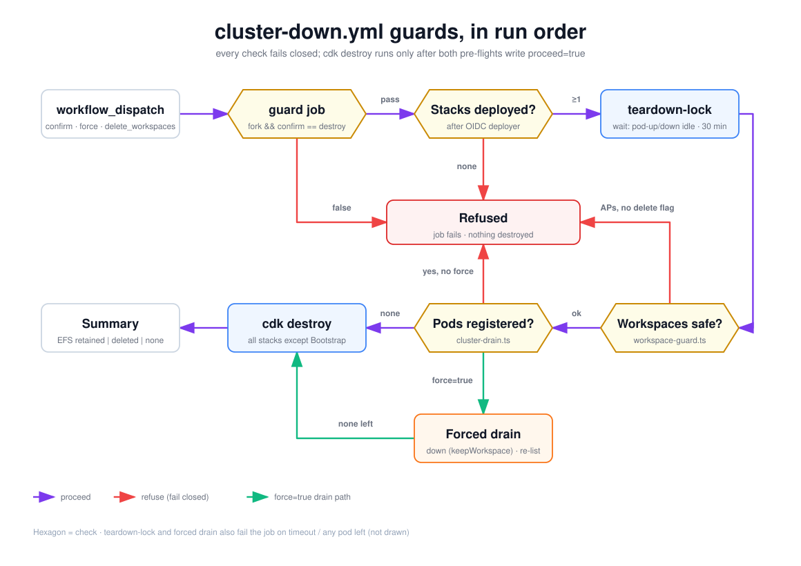

# cluster-down.yml guards, in run order

The checks `cluster-down.yml` runs before it lets `cdk destroy` touch anything, in the order they appear in the workflow. Every check fails closed. Both pre-flight scripts must also write `proceed=true` to `$GITHUB_OUTPUT`, because an exit code of 0 alone is not trusted. Read it when a cluster-down refused and you need to know which guard stopped it, or before running it with `force` or `delete_workspaces`.

## How to read it

- **Hexagon**: a check. **Rounded rectangle**: a step.
- **Purple arrow**: the check passed and the run continues. **Red arrow**: the check refused, so the job fails (or, for the guard job, the destroy job is skipped) and nothing is destroyed. **Green arrow**: the `force=true` drain path.
- The main path snakes left to right across the top row, down the right edge, then right to left across the bottom row.

## Walkthrough

1. **Dispatch** with `confirm`, `force` (default false) and `delete_workspaces` (default false).
2. **guard job.** It runs only in a fork and only when `confirm == 'destroy'`. Otherwise the `destroy` job, which `needs: guard`, is skipped.
3. **Stacks deployed?** `scripts/stack-names.ts --cluster` resolves every stack except Bootstrap from `naming.prefix`. The job assumes the deployer role through OIDC, then fails unless at least one of those stacks exists in CloudFormation. This stops a mismatched prefix from draining pods and then destroying nothing.
4. **teardown-lock (`wait` mode).** [`teardown-lock`](../../../.github/actions/teardown-lock/action.yml) waits until no `pod-up` / `pod-down` run is queued or running, and fails after 30 minutes. `pod-up` and `pod-down` call the same action in `refuse` mode, so they won't start while a cluster-down is active.
5. **Workspaces safe?** [`cluster-workspace-guard.ts`](../../../scripts/cluster-workspace-guard.ts) reads the deployed EFS `DeletionPolicy` (ADR 0007). It proceeds if the Cluster stack or its EFS file system is already gone, if the policy is RETAIN (`efs.retainOnClusterDown: true` deployed), if the policy is DESTROY with no access points, or if `delete_workspaces=true`. It refuses when access points (pod workspaces) exist under DESTROY without the flag. An unexpected error also refuses, unless `delete_workspaces=true`; in that case the run proceeds, because you already agreed to lose the workspaces. A follow-up step fails the job if the script exited 0 without writing `proceed=true`.
6. **Pods registered?** [`cluster-drain.ts`](../../../scripts/cluster-drain.ts) calls the pod-manager Lambda's `list` action. With no pods it proceeds. With pods and no `force`, it refuses.
7. **Forced drain** (`force=true`). The script calls `down` for each pod with `keepWorkspace: true`, then lists again. It proceeds only if no pods remain. Any failed `down` or leftover pod fails the job (not drawn). A proof step checks `proceed=true` here too.
8. **cdk destroy** runs only when both `steps.workspace_guard.outputs.proceed` and `steps.drain.outputs.proceed` are `'true'`. It destroys every stack except Bootstrap, and `cdk destroy` works out the dependency order itself. The workflow does not hard-code a stack order.
9. **Summary** reports EFS as retained, deleted or none, based on the guard's `efs_action` output.

Note the order: the workspace guard runs **before** the drain. That way no pod is stopped if the run is going to refuse over workspaces anyway, and because both run after the lock, a `pod-up` can't add a workspace behind the check.

## Elements and sources

| Element | What it is | Source |
| --- | --- | --- |
| workflow_dispatch | Inputs `confirm`, `force`, `delete_workspaces` | `.github/workflows/cluster-down.yml:36-52` |
| guard job | Fork-only and `confirm == 'destroy'` | `.github/workflows/cluster-down.yml:69-75` |
| Stacks deployed? | Resolve names, OIDC deployer, `describe-stacks` | `.github/workflows/cluster-down.yml:99-139` |
| teardown-lock | `wait` mode, 30-minute default timeout | `.github/workflows/cluster-down.yml:144-147`, `.github/actions/teardown-lock/action.yml:17`, `.github/actions/teardown-lock/action.yml:50-67` |
| Workspaces safe? | EFS workspace guard + proof step; absent stack/EFS proceeds; error proceeds only with `delete_workspaces` | `.github/workflows/cluster-down.yml:154-172`, `scripts/cluster-workspace-guard.ts:155-266`, `scripts/cluster-workspace-guard.ts:159-169`, `scripts/cluster-workspace-guard.ts:176-215` |
| Pods registered? | Drain pre-flight, `list` action | `.github/workflows/cluster-down.yml:174-197`, `scripts/cluster-drain.ts:98-109` |
| Forced drain | `down` with `keepWorkspace: true`, then re-list | `scripts/cluster-drain.ts:121-157` |
| cdk destroy | All stacks except Bootstrap, gated on both proofs | `.github/workflows/cluster-down.yml:199-209` |
| Summary | EFS retained / deleted / none | `.github/workflows/cluster-down.yml:211-234` |
| Refused | Job fails, or destroy job skipped | `.github/workflows/cluster-down.yml:71`, `.github/workflows/cluster-down.yml:168-172`, `.github/workflows/cluster-down.yml:193-197` |
| Edge: dispatch to guard | `guard` runs first | `.github/workflows/cluster-down.yml:69-71` |
| Edge: guard to Stacks deployed? ("pass") | `destroy` job `needs: guard` | `.github/workflows/cluster-down.yml:77-78` |
| Edge: guard to Refused ("false") | `if:` false skips guard, so destroy is skipped | `.github/workflows/cluster-down.yml:71` |
| Edge: Stacks deployed? to Refused ("none") | `exit 1` when no stack is found | `.github/workflows/cluster-down.yml:135-138` |
| Edge: Stacks deployed? to teardown-lock ("≥1") | At least one stack is deployed | `.github/workflows/cluster-down.yml:139-147` |
| Edge: teardown-lock to Workspaces safe? | Guard runs after the lock | `.github/workflows/cluster-down.yml:149-154` |
| Edge: Workspaces safe? to Refused ("APs, no delete flag") | DESTROY + access points without `--delete-workspaces` | `scripts/cluster-workspace-guard.ts:253-266` |
| Edge: Workspaces safe? to Pods registered? ("ok") | `proceed=true` written | `scripts/cluster-workspace-guard.ts:284-288` |
| Edge: Pods registered? to Refused ("yes, no force") | Refuse unless `force` | `scripts/cluster-drain.ts:113-118` |
| Edge: Pods registered? to cdk destroy ("none") | No pods registered | `scripts/cluster-drain.ts:108-109` |
| Edge: Pods registered? to Forced drain ("force=true") | `--force` passed from the input | `.github/workflows/cluster-down.yml:182-188` |
| Edge: Forced drain to cdk destroy ("none left") | Re-list is empty, proceed | `scripts/cluster-drain.ts:141-155` |
| Edge: cdk destroy to Summary | Summary step | `.github/workflows/cluster-down.yml:211` |

## Related

- [Workflows, GitHub OIDC and the two IAM roles](workflows-and-iam-roles.md)
- [Teardown](../../teardown.md)
- [Troubleshooting](../../troubleshooting.md)
- [ADR 0007: EFS cluster removal policy](../../adr/0007-efs-cluster-removal-policy.md)
- [ADR 0004: EFS per-pod access point](../../adr/0004-efs-per-pod-access-point.md)

Regenerate: see [../README.md#regenerating](../README.md#regenerating).
