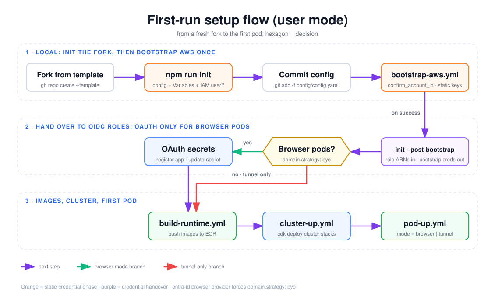

# First-run setup flow (user mode)

The order of steps that takes a fresh fork of the template to its first running pod. Credentials move from a temporary static-key phase to OIDC-only. Read it before your first setup, or when a re-entering session has to work out which step it stopped at.

## How to read it

- Read the three bands top to bottom. Within a band, follow the arrows (row 2 runs right to left).
- **Rounded rectangle**: a step you run (a local command or a `gh workflow run`).
- **Hexagon**: a decision. The template generator has no diamond shape, so hexagons mark decisions.
- **Purple arrow**: the next step. **Green**: the browser-mode branch. **Red**: the tunnel-only branch, which skips OAuth setup.
- **Orange nodes**: steps that rely on the static bootstrap credentials. **Purple node**: the handover that removes them.

## Walkthrough

1. **Fork from template.** `gh repo create <user>/<repo> --template foolswithtools/cloud-dev-pods --private` (see [`setup-cli.md`](../../setup-cli.md)).
2. **`npm run init`** ([`init-clone.ts`](../../../scripts/init-clone.ts)) asks for the browser provider (`github` or `entra-id`) and domain strategy (`byo` = your own Route53 zone, `alb-default` = no domain, tunnel pods only). Choosing `entra-id` forces `byo`. It then writes `config/config.yaml`, `.upstream-sync.state`, `.envrc` and an `infra/extensions.local.ts` stub, and pushes the `AWS_REGION`, `AWS_ACCOUNT_ID` and `CLUSTER_NAME` repo Variables. If you agree, it also creates the `cloud-dev-pods-bootstrap` IAM user with `AdministratorAccess` and pushes its access key as the `AWS_BOOTSTRAP_*` repo Secrets through stdin.
3. **Commit config.** `git add -f config/config.yaml && git add infra/extensions.local.ts`, commit, push. CI reads the committed config.
4. **`bootstrap-aws.yml`** checks that the static keys belong to `confirm_account_id`, then runs `cdk bootstrap` and deploys `BootstrapStack`: the OIDC provider, both roles, ECR repos and placeholder OAuth secrets ([`bootstrap-aws.yml`](../../../.github/workflows/bootstrap-aws.yml)).
5. **`npm run init -- --post-bootstrap`** works through its steps in a fixed security order and stops at the first failure: read both role ARNs from SSM, set and read back `AWS_DEPLOYER_ROLE_ARN` / `AWS_POD_OPS_ROLE_ARN`, delete the `AWS_BOOTSTRAP_*` Secrets, then delete the IAM user's access keys, the policy attachment and the user. Before deleting the IAM user it asks for confirmation (unless `--yes`). If you decline, it exits 1 and keeps the user, which still has `AdministratorAccess`. Nothing is deleted unless the Variables are verified first, and it is safe to re-run.
6. **Browser pods?** This is the `domain.strategy` chosen in step 2. With `byo`, register the OAuth client (a GitHub OAuth App, or an Entra app per [`setup-entra.md`](../../setup-entra.md)) and store its ID and secret with `aws secretsmanager update-secret`. With `alb-default` (tunnel only), skip this step.
7. **`build-runtime.yml`** builds the runtime images and pushes them to ECR, tagged with the commit SHA.
8. **`cluster-up.yml`** deploys the cluster stacks with the deployer role.
9. **`pod-up.yml`** starts the first pod with `mode` set to `browser` or `tunnel`.

## Elements and sources

| Element | What it is | Source |
| --- | --- | --- |
| Fork from template | `gh repo create --template` | `docs/setup-cli.md:23`, `CLAUDE.md:91` |
| npm run init | Interactive init: config, Variables, optional IAM user | `scripts/init-clone.ts:7-12`, `scripts/init-clone.ts:1220-1260` |
| Provider / domain prompts (in init) | `entra-id` forces `byo`; `alb-default` = tunnel only | `scripts/init-clone.ts:260-279` |
| Optional bootstrap IAM user + Secrets | create-user, AdministratorAccess, access key, `gh secret set` | `scripts/init-clone.ts:785-834` |
| Commit config | `git add -f config/config.yaml` | `scripts/init-clone.ts:839` |
| bootstrap-aws.yml | Account check, cdk bootstrap, BootstrapStack | `.github/workflows/bootstrap-aws.yml:12-16`, `.github/workflows/bootstrap-aws.yml:55-92` |
| init --post-bootstrap | SSM, Variables, Secrets, IAM user, in order; asks before deleting the user | `scripts/init-clone.ts:958-1102`, `scripts/init-clone.ts:1042-1058` |
| Browser pods? (decision) | `domain.strategy: byo` vs `alb-default` | `scripts/init-clone.ts:264-279`, `scripts/init-clone.ts:844-862` |
| OAuth secrets | Register client, `update-secret` client-id / client-secret | `scripts/init-clone.ts:844-859`, `docs/setup-cli.md:183-185` |
| build-runtime.yml | Image build and ECR push | `.github/workflows/build-runtime.yml:80`, `.github/workflows/build-runtime.yml:116` |
| cluster-up.yml | `cdk deploy` of cluster stacks | `.github/workflows/cluster-up.yml:96-105` |
| pod-up.yml | `mode` input, browser or tunnel | `.github/workflows/pod-up.yml:20-26` |
| Edges: fork to init to commit to bootstrap-aws | Order printed by init's next steps | `scripts/init-clone.ts:837-843` |
| Edge: bootstrap-aws to post-bootstrap ("on success") | Workflow summary tells you to run `--post-bootstrap` | `.github/workflows/bootstrap-aws.yml:105-116` |
| Edge: post-bootstrap to decision | Next steps continue after step 3 | `scripts/init-clone.ts:841-844` |
| Edge: decision to OAuth secrets ("yes") | `entra-id` / `byo` branches of `nextSteps` | `scripts/init-clone.ts:844-859` |
| Edge: decision to build-runtime ("no, tunnel only") | `else` branch goes straight to build | `scripts/init-clone.ts:860-862` |
| Edges: OAuth to build-runtime to cluster-up | `gh workflow run build-runtime.yml`, then `cluster-up.yml` | `scripts/init-clone.ts:863-866` |
| Edge: cluster-up to pod-up | First pod after the cluster | `CLAUDE.md:246-250` |

## Related

- [Workflows, GitHub OIDC and the two IAM roles](workflows-and-iam-roles.md)
- [cluster-down guards](cluster-down-guards.md)
- [Setup with the CLI](../../setup-cli.md)
- [Choosing auth and access](../../choosing-auth-and-access.md)
- [Cost controls](../../cost-controls.md): set a budget alarm before `cluster-up`

Regenerate: see [../README.md#regenerating](../README.md#regenerating).
