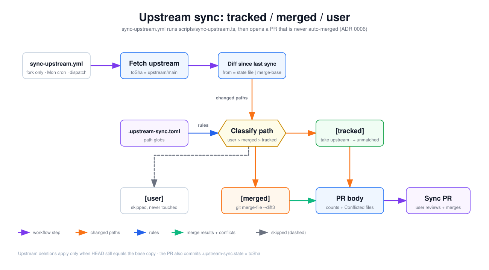

# Upstream sync: tracked / merged / user

How a fork picks up changes from `foolswithtools/cloud-dev-pods`. [`sync-upstream.yml`](../../../.github/workflows/sync-upstream.yml) runs [`sync-upstream.ts`](../../../scripts/sync-upstream.ts), which sorts every changed path into one of the three classes in [`.upstream-sync.toml`](../../../.upstream-sync.toml) (ADR 0006) and opens a pull request for you to review. Read it before resolving a sync PR, or before deciding where a customization should live.

## How to read it

- Read left to right, then down. **Hexagon**: the classification decision. **Rounded rectangles**: steps or outcomes.
- **Purple arrow**: a workflow step. **Orange**: changed paths moving through the script. **Blue**: classification rules read from the TOML file. **Green**: merge results, including conflicts, feeding the PR body. **Dashed gray**: paths that are skipped.

## Walkthrough

1. **Trigger.** A weekly cron (Mondays 09:17 UTC) or a manual dispatch with optional `upstream_url` / `upstream_branch`. A `guard` job skips the run on the upstream repo itself. The workflow uses no AWS credentials, only `contents: write` and `pull-requests: write`.
2. **Fetch upstream.** The script adds or updates the `upstream` remote, fetches the branch, and records `toSha`.
3. **Diff since last sync.** `fromSha` comes from `.upstream-sync.state`. On the first sync, when that file is absent, it falls back to `git merge-base HEAD upstream/<branch>`. `git diff --name-status fromSha toSha` lists the changed paths. If `fromSha == toSha`, the run reports zero files and no PR is opened.
4. **Classify path.** Globs are checked in precedence order: `[user]` first, then `[merged]`, then `[tracked]`. A path that matches nothing is treated as tracked and listed as "unmatched".
5. **`[user]`** paths (for example `config/config.yaml`, `infra/extensions.local.ts`, `*.local.*`, `CLAUDE.md`, `README.md`) are skipped and never touched. Caveat: globs are matched with `matchBase: false`, so `*.local.*` only matches files at the repo root. Nested files such as `infra/extensions.local.ts` and `infra/config.local.ts` are covered by their own explicit entries in the TOML.
6. **`[tracked]`** paths (for example `infra/lib/**`, `scripts/**`, `docs/**`, `ci-*.yml`) are overwritten with the upstream copy (`git checkout toSha -- <path>`).
7. **`[merged]`** paths (for example `.github/workflows/*pod*.yml`, `.github/workflows/cluster-*.yml`, `package.json`, `.gitignore`) get a three-way merge, `git merge-file -p --diff3 ours base theirs`. If the merge conflicts, the file is written with conflict markers and listed as conflicted.
8. **Deletions** (footer): a path deleted upstream is deleted locally only if `HEAD` still matches the base copy. Otherwise it is kept and counted as skipped.
9. **PR body.** A table of counts (tracked, merged, conflicts, skipped, deleted, unmatched) plus a `### Conflicted files (resolve before merging)` list when there are conflicts.
10. **Sync PR.** `peter-evans/create-pull-request` commits the working tree, including the new `.upstream-sync.state = toSha`, to `chore/sync-upstream-<toSha>`. It is never auto-merged. Follow the sync-upstream playbook in `CLAUDE.md` to resolve conflicts.

## Elements and sources

| Element | What it is | Source |
| --- | --- | --- |
| sync-upstream.yml | Cron + dispatch, fork-only guard | `.github/workflows/sync-upstream.yml:6-31` |
| Fetch upstream | `remote add/set-url`, `fetch`, `rev-parse` | `scripts/sync-upstream.ts:103-119` |
| Diff since last sync | State file or merge-base, `git diff --name-status` | `scripts/sync-upstream.ts:121-146`, `scripts/sync-upstream.ts:311-318` |
| .upstream-sync.toml | tracked / merged / user globs | `.upstream-sync.toml:10-71`, `scripts/sync-upstream.ts:90-101` |
| Classify path | Precedence user, merged, tracked, else unmatched; `matchBase: false` | `scripts/sync-upstream.ts:148-153`, `scripts/sync-upstream.ts:155-157` |
| [tracked] | Overwrite from upstream (also unmatched) | `scripts/sync-upstream.ts:159-164`, `scripts/sync-upstream.ts:352-354` |
| [user] | Skipped | `scripts/sync-upstream.ts:329-332` |
| [merged] | `git merge-file -p --diff3` | `scripts/sync-upstream.ts:194-256`, `scripts/sync-upstream.ts:356-363` |
| PR body | Counts table + conflicted-files block | `.github/workflows/sync-upstream.yml:79-114` |
| Sync PR | create-pull-request, never auto-merged | `.github/workflows/sync-upstream.yml:116-129` |
| Footer: deletions | Delete only when HEAD == base | `scripts/sync-upstream.ts:337-348` |
| Footer: state file | `.upstream-sync.state = toSha` | `scripts/sync-upstream.ts:369` |
| Edge: workflow to fetch | Run sync script step | `.github/workflows/sync-upstream.yml:54-60` |
| Edge: fetch to diff | `toSha`, then `fromSha` | `scripts/sync-upstream.ts:308-309` |
| Edge: diff to classify ("changed paths") | Loop over changes | `scripts/sync-upstream.ts:320`, `scripts/sync-upstream.ts:327-328` |
| Edge: toml to classify ("rules") | `loadToml()` feeds `classify()` | `scripts/sync-upstream.ts:306`, `scripts/sync-upstream.ts:328` |
| Edge: classify to [tracked] | `tracked` or `unmatched` | `scripts/sync-upstream.ts:352-354` |
| Edge: classify to [user] (dashed) | `user` skipped | `scripts/sync-upstream.ts:329-332` |
| Edge: classify to [merged] | `merged` branch | `scripts/sync-upstream.ts:355-363` |
| Edge: [tracked] to PR body | `tracked_count` output | `.github/workflows/sync-upstream.yml:66`, `.github/workflows/sync-upstream.yml:101` |
| Edge: [merged] to PR body | `merged_count`, `conflicted` list | `.github/workflows/sync-upstream.yml:67-68`, `.github/workflows/sync-upstream.yml:84-90` |
| Edge: PR body to Sync PR | `body:` input | `.github/workflows/sync-upstream.yml:124` |

## Related

- [Workflows, GitHub OIDC and the two IAM roles](workflows-and-iam-roles.md)
- [ADR 0006: tracked / merged / user sync taxonomy](../../adr/0006-tracked-merged-user-sync-taxonomy.md)
- [Extending without forking tracked files](../../extending.md)

Regenerate: see [../README.md#regenerating](../README.md#regenerating).
