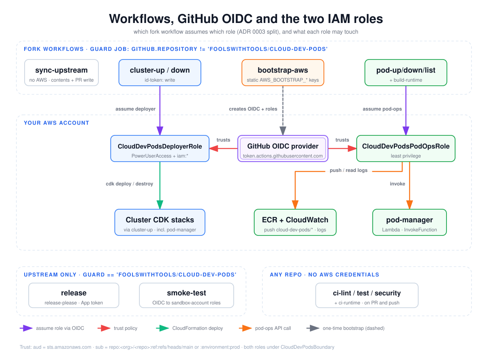

# Workflows, GitHub OIDC and the two IAM roles

This diagram maps every GitHub Actions workflow to the AWS identity it runs as. Fork workflows that touch AWS assume one of two IAM roles through GitHub OIDC: `CloudDevPodsDeployerRole` for CloudFormation, `CloudDevPodsPodOpsRole` for day-to-day pod operations. Read it when you are reviewing what a compromised workflow could reach, or deciding which repo Variable a new workflow needs.

## How to read it

- **Top band**: workflows that run only in forks. Each one has a `guard` job with `if: github.repository != 'foolswithtools/cloud-dev-pods'`, so on the upstream template they do nothing.
- **Middle band**: your AWS account. Only the OIDC provider and the two roles (plus the ECR repos and OAuth secrets, not drawn) come from `BootstrapStack`. The cluster CDK stacks, which include the `pod-manager` Lambda, are deployed later by `cluster-up`.
- **Bottom bands**: workflows that never use your account's roles. `release` and `smoke-test` run only on upstream. The `ci-*` workflows run in any repo but get no AWS credentials.
- **Purple arrow**: the workflow assumes a role through OIDC (the role ARN comes from a repo Variable).
- **Red arrow**: the role's trust policy names the GitHub OIDC provider as its principal.
- **Green arrow**: CloudFormation deploy or destroy through CDK.
- **Orange arrow**: a pod-ops API call (Lambda invoke, ECR push, CloudWatch Logs read).
- **Dashed gray arrow**: the one-time bootstrap, which runs on static keys, not OIDC.
- Node colors follow the role: blue for deployer, green for pod-ops, orange for the static-key bootstrap.

## Walkthrough

1. **`bootstrap-aws.yml`** is the only fork workflow that uses long-lived keys. It calls `aws-actions/configure-aws-credentials` with the `AWS_BOOTSTRAP_*` repo Secrets, runs `cdk bootstrap`, then deploys `BootstrapStack` ([`bootstrap-aws.yml`](../../../.github/workflows/bootstrap-aws.yml)). It never assumes `AWS_DEPLOYER_ROLE_ARN`, even on a re-run.
2. **`BootstrapStack`** creates the GitHub OIDC provider, the permissions boundary `CloudDevPodsBoundary`, both roles, the ECR repos and the OAuth secrets, and writes both role ARNs to SSM ([`bootstrap-stack.ts`](../../../infra/lib/stacks/bootstrap-stack.ts)). `npm run init -- --post-bootstrap` copies those ARNs into the `AWS_DEPLOYER_ROLE_ARN` and `AWS_POD_OPS_ROLE_ARN` repo Variables.
3. **Trust.** Both roles share one principal. The OIDC token must have `aud = sts.amazonaws.com`, and `sub` must match `repo:<org>/<repo>:ref:refs/heads/main` or `repo:<org>/<repo>:environment:prod`. In practice, workflows get AWS access only when they run from `main`. No fork workflow sets `environment: prod` today.
4. **`cluster-up` / `cluster-down`** request `id-token: write` and assume the deployer role through the composite action [`aws-oidc`](../../../.github/actions/aws-oidc/action.yml), a thin wrapper around `configure-aws-credentials`. The deployer role has `PowerUserAccess` plus `iam:*`, bounded by `CloudDevPodsBoundary`, and runs `cdk deploy` / `cdk destroy` on the cluster stacks.
5. **`pod-up` / `pod-down` / `pod-list` / `build-runtime`** assume the pod-ops role. That role can only invoke the Lambda named `pod-manager`, push to and pull from ECR repos under `cloud-dev-pods/*`, and read log events under `/cloud-dev-pods/*`. The pod workflows call the Lambda through [`pod-cli.ts`](../../../scripts/pod-cli.ts). `build-runtime` pushes images.
6. **`sync-upstream`** is fork-only but uses no AWS at all. It needs only `contents: write` and `pull-requests: write`; see [upstream-sync](upstream-sync.md).
7. **Upstream-only workflows.** `release` runs release-please with a GitHub App token. `smoke-test` is gated on the upstream repo plus `SANDBOX_ENABLED`, runs in the `smoke-sandbox` environment, and assumes the `SANDBOX_*` role ARNs, which are roles in a separate sandbox account, not yours.
8. **`ci-*`** (lint, test, security, runtime) have no repository guard. They run on pull requests and pushes in forks too, with no AWS step.

## Elements and sources

| Element | What it is | Source |
| --- | --- | --- |
| Fork workflows band (guard) | `guard` job skipped on upstream | `.github/workflows/cluster-up.yml:25`, `.github/workflows/pod-up.yml:64`, `.github/workflows/bootstrap-aws.yml:23` |
| sync-upstream | Fork-only, no AWS, contents + PR write | `.github/workflows/sync-upstream.yml:27`, `.github/workflows/sync-upstream.yml:37-38` |
| cluster-up / down | Deployer-role workflows, `id-token: write` | `.github/workflows/cluster-up.yml:35`, `.github/workflows/cluster-down.yml:81` |
| bootstrap-aws | Static-key bootstrap | `.github/workflows/bootstrap-aws.yml:48-53` |
| pod-up/down/list + build-runtime | Pod-ops-role workflows | `.github/workflows/pod-up.yml:74`, `.github/workflows/pod-down.yml:34`, `.github/workflows/pod-list.yml:22`, `.github/workflows/build-runtime.yml:49` |
| GitHub OIDC provider | `token.actions.githubusercontent.com`, client `sts.amazonaws.com` | `infra/lib/stacks/bootstrap-stack.ts:35-38` |
| CloudDevPodsDeployerRole | PowerUserAccess + `iam:*`, bounded | `infra/lib/stacks/bootstrap-stack.ts:98-118` |
| CloudDevPodsPodOpsRole | Least-privilege pod ops role, bounded | `infra/lib/stacks/bootstrap-stack.ts:122-168` |
| Cluster CDK stacks | Every stack except Bootstrap, deployed by `cluster-up` (includes PodManager) | `scripts/stack-names.ts:12`, `.github/workflows/cluster-up.yml:96-105` |
| ECR + CloudWatch | `cloud-dev-pods/*` repos, `/cloud-dev-pods/*` log groups | `infra/lib/stacks/bootstrap-stack.ts:146-166`, `infra/lib/stacks/bootstrap-stack.ts:171-184` |
| pod-manager Lambda | Only function pod-ops may invoke | `infra/lib/stacks/bootstrap-stack.ts:130-137` |
| release | Upstream-only release-please | `.github/workflows/release.yml:28-32` |
| smoke-test | Upstream-only, sandbox roles | `.github/workflows/smoke-test.yml:34`, `.github/workflows/smoke-test.yml:45`, `.github/workflows/smoke-test.yml:65` |
| ci-lint / test / security / runtime | PR + push, no repo guard | `.github/workflows/ci-lint.yml:6-8`, `.github/workflows/ci-test.yml:7-9`, `.github/workflows/ci-security.yml:6-8`, `.github/workflows/ci-runtime.yml:8-13` |
| Edge: cluster-up/down to deployer ("assume deployer") | `role-to-assume: vars.AWS_DEPLOYER_ROLE_ARN` | `.github/workflows/cluster-up.yml:71-73`, `.github/workflows/cluster-down.yml:114-116` |
| Edge: pod workflows to pod-ops ("assume pod-ops") | `role-to-assume: vars.AWS_POD_OPS_ROLE_ARN` | `.github/workflows/pod-up.yml:101`, `.github/workflows/pod-down.yml:61`, `.github/workflows/pod-list.yml:40`, `.github/workflows/build-runtime.yml:62` |
| Edge: bootstrap-aws to OIDC ("creates OIDC + roles") | `cdk deploy` of BootstrapStack | `.github/workflows/bootstrap-aws.yml:87-92` |
| Edges: OIDC to both roles ("trusts") | Shared `OpenIdConnectPrincipal`, `aud` + `sub` conditions | `infra/lib/stacks/bootstrap-stack.ts:83-96`, `infra/lib/stacks/bootstrap-stack.ts:101`, `infra/lib/stacks/bootstrap-stack.ts:125` |
| Edge: deployer to stacks ("cdk deploy / destroy") | Cluster deploy and teardown | `.github/workflows/cluster-up.yml:105`, `.github/workflows/cluster-down.yml:209` |
| Edge: pod-ops to ECR + CloudWatch ("push / read logs") | Image push, tunnel log polling | `.github/workflows/build-runtime.yml:116`, `.github/workflows/pod-up.yml:176` |
| Edge: pod-ops to pod-manager ("invoke") | `lambda:InvokeFunction` through pod-cli | `scripts/pod-cli.ts:111-122`, `.github/workflows/pod-list.yml:49` |
| Footer: permissions boundary | `CloudDevPodsBoundary` on both roles | `infra/lib/stacks/bootstrap-stack.ts:42-81`, `infra/lib/stacks/bootstrap-stack.ts:102`, `infra/lib/stacks/bootstrap-stack.ts:126` |

## Related

- [First-run setup flow](first-run-setup-flow.md): when the role ARN Variables get set
- [cluster-down guards](cluster-down-guards.md)
- [Upstream sync](upstream-sync.md)
- [ADR 0003: pod-manager Lambda](../../adr/0003-pod-manager-lambda.md)
- [AWS permissions](../../aws-permissions.md)

Regenerate: see [../README.md#regenerating](../README.md#regenerating).
