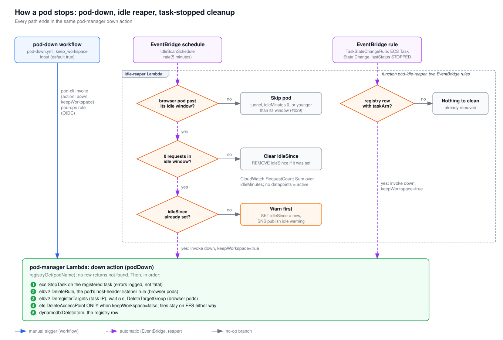

# How a pod stops

A pod is stopped in one of three ways: someone runs `pod-down.yml`, the idle reaper's 5-minute scan finds an idle browser pod, or an EventBridge rule reports that the pod's ECS task stopped on its own. All three call the same pod-manager `down` action, and the box at the bottom lists exactly what that action removes. Read this to find out why a pod disappeared, or what survives a stop.

## How to read it

- Blue arrows show the manual path through the workflow. Dashed purple arrows show automatic paths (EventBridge and the idle-reaper Lambda). Gray arrows are branches that stop nothing.
- Orange diamonds are decisions made in the idle-reaper code.
- The dashed frame groups everything that runs inside the one `pod-idle-reaper` function, which both EventBridge rules invoke.
- The green box is `podDown` in the pod-manager Lambda. Its numbered steps run in order.

## Walkthrough

1. **pod-down workflow.** [`pod-down.yml`](../../../.github/workflows/pod-down.yml) assumes the pod-ops role through OIDC. It passes `--keep-workspace` only when the `keep_workspace` input is true, which is the default. [`pod-cli.ts`](../../../scripts/pod-cli.ts) sends `keepWorkspace: true` only when that flag is present, so unchecking the input releases the workspace.
2. **Idle scan** (EventBridge `rate(5 minutes)`). [`handler.ts`](../../../infra/lambda/idle-reaper/handler.ts) scans the registry and checks only browser pods that have a target group, `idleMinutes` other than 0, and an age greater than their idle window. Tunnel pods are never idle-reaped.
3. It reads the CloudWatch `AWS/ApplicationELB` `RequestCount` Sum for the pod's target group and load balancer over the idle window. No datapoints counts as active.
4. If the pod had requests, `idleSince` is removed. On the first idle detection, it sets `idleSince` and publishes an SNS warning. On the next idle scan, if `idleSince` is still set, it invokes `down` with `keepWorkspace: true`.
5. **Task stopped** (EventBridge `ECS Task State Change`, `lastStatus` STOPPED, this cluster only). The reaper looks for a registry row with that `taskArn`. If it finds one (the task crashed or was stopped outside pod-down), it invokes `down` with `keepWorkspace: true`. After a normal pod-down the row is usually gone already, and nothing happens.
6. **pod-manager down** ([`actions.ts`](../../../infra/lambda/pod-manager/actions.ts)) returns `not-found` when there's no row. Otherwise it stops the task, deletes the listener rule, deregisters the task IP, waits 5 s, deletes the target group, deletes the access point only when `keepWorkspace` is false, and deletes the registry row. AWS errors from the stop, rule and target group calls are logged rather than thrown.

**What survives:** with `keepWorkspace: true`, the EFS access point stays, so the next `pod-up` with the same name reattaches the same `/workspace`. With `false`, only the access point is deleted. The files under `/pods/<pod>-<hex>` stay on EFS, but nothing can reach them, because the next pod-up creates a fresh random path. Task definition revisions aren't deregistered.

## Elements and sources

| Element | What it is | Source |
| --- | --- | --- |
| pod-down workflow | `keep_workspace` input, default true | `.github/workflows/pod-down.yml:13` |
| pod-cli Invoke `{down, keepWorkspace}` | Flag becomes boolean | `.github/workflows/pod-down.yml:70`, `scripts/pod-cli.ts:75` |
| pod-ops role (OIDC) | Workflow OIDC step | `.github/workflows/pod-down.yml:58` |
| EventBridge schedule | `IdleScanSchedule`, `rate(5 minutes)` | `infra/lib/stacks/idle-reaper-stack.ts:86` |
| EventBridge rule | `TaskStateChangeRule`, STOPPED in cluster | `infra/lib/stacks/idle-reaper-stack.ts:93` |
| idle-reaper Lambda frame | Function `pod-idle-reaper`, dispatch by event source | `infra/lib/stacks/idle-reaper-stack.ts:44`, `infra/lambda/idle-reaper/handler.ts:216` |
| Decision: browser pod past its idle window? | Mode, target group, `idleMinutes`, age (#229) | `infra/lambda/idle-reaper/handler.ts:153` |
| Skip pod | `continue` branches | `infra/lambda/idle-reaper/handler.ts:153` |
| Decision: 0 requests in idle window? | `browserIdleSince`, RequestCount Sum | `infra/lambda/idle-reaper/handler.ts:69` |
| CloudWatch annotation | No datapoints means not idle | `infra/lambda/idle-reaper/handler.ts:94` |
| Clear idleSince | `REMOVE idleSince` | `infra/lambda/idle-reaper/handler.ts:167`, `infra/lambda/idle-reaper/handler.ts:112` |
| Decision: idleSince already set? | Two-phase shutdown | `infra/lambda/idle-reaper/handler.ts:170` |
| Warn first | `setIdleSince` + `notifyIdle` (SNS) | `infra/lambda/idle-reaper/handler.ts:171` |
| yes: invoke down (idle) | `invokeDown`, `keepWorkspace: true` | `infra/lambda/idle-reaper/handler.ts:176`, `infra/lambda/idle-reaper/handler.ts:132` |
| Decision: registry row with taskArn? | `handleTaskStateChange` | `infra/lambda/idle-reaper/handler.ts:199` |
| Nothing to clean | No matching row | `infra/lambda/idle-reaper/handler.ts:201` |
| yes: invoke down (task stopped) | `invokeDown(pod.podName)` | `infra/lambda/idle-reaper/handler.ts:206` |
| pod-manager down | `podDown`, not-found when no row | `infra/lambda/pod-manager/actions.ts:262` |
| 1. StopTask | `stopTask`, errors logged | `infra/lambda/pod-manager/aws.ts:444` |
| 2. DeleteRule | `deleteListenerRule` | `infra/lambda/pod-manager/aws.ts:559` |
| 3. DeregisterTargets, 5 s, DeleteTargetGroup | `deregisterAndDeleteTargetGroup` | `infra/lambda/pod-manager/aws.ts:567` |
| 4. DeleteAccessPoint if keepWorkspace=false | Conditional delete | `infra/lambda/pod-manager/actions.ts:279` |
| 5. DeleteItem | `registryDelete` | `infra/lambda/pod-manager/actions.ts:282` |

## Related

- [pod-up sequence](pod-up-sequence.md)
- [Pod lifecycle states](pod-state-machine.md)
- [ADR 0003: pod-manager Lambda](../../adr/0003-pod-manager-lambda.md)
- [ADR 0004: EFS per-pod access point](../../adr/0004-efs-per-pod-access-point.md)
- [ADR 0007: EFS cluster removal policy](../../adr/0007-efs-cluster-removal-policy.md)
- [Cost controls](../../cost-controls.md)

Regenerate: see [../README.md#regenerating](../README.md#regenerating).
