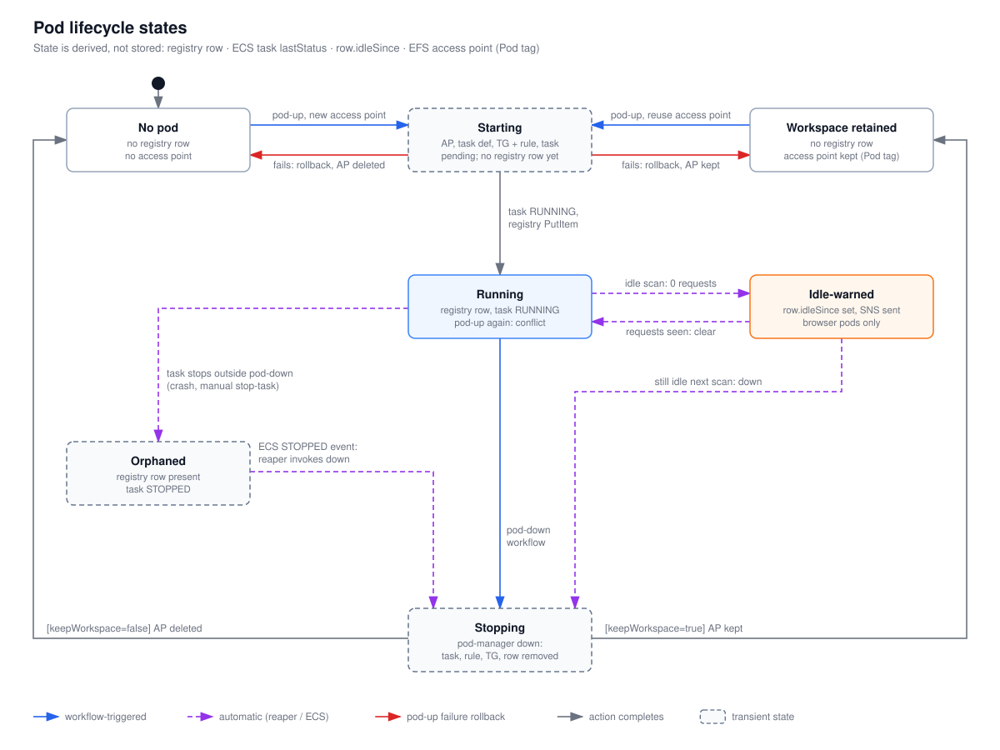

# Pod lifecycle states

These are the states a pod moves through, with the event behind each transition. The code stores no status field. Each state is derived from four facts: whether a registry row exists, the ECS task's `lastStatus`, whether `idleSince` is set on the row, and whether an EFS access point tagged with the pod's name exists. Read this to work out what a pod's current AWS footprint means.

## How to read it

- Solid boxes are steady states. Dashed boxes are transient: they last only while a Lambda runs, or until an EventBridge event is handled.
- Blue arrows are workflow-triggered (`pod-up.yml`, `pod-down.yml`). Dashed purple arrows are automatic (the idle reaper or an ECS event). Red arrows are pod-up rollbacks. Gray arrows are a pod-manager action completing.
- `[guard]` labels give the condition for that transition.

## Walkthrough

1. **No pod**: no registry row and no access point. This is the starting state, and also the state after a workspace is released.
2. **Starting**: `pod-up` is running. The access point exists (created or reused), and the task definition, the target group and rule (browser only) and the pending task are being created. There's no registry row yet, because the row is written last.
3. If anything in that window fails, pod-up rolls back. It goes back to **No pod** if the access point was created in this run, or to **Workspace retained** if it was reused.
4. **Running**: the task reached `RUNNING` and the row was written. Running `pod-up` again with the same name returns `conflict`, and so does running it on an Idle-warned or Orphaned pod, because any existing row blocks pod-up.
5. **Idle-warned** (browser pods only): a reaper scan found 0 requests over the idle window, set `idleSince` and sent an SNS warning. If requests are seen again, `idleSince` is cleared. If the next scan is still idle, the reaper invokes `down`.
6. **Orphaned**: the row still exists, but the task stopped outside pod-down (a crash, or a manual `stop-task`). The ECS STOPPED event makes the reaper invoke `down`.
7. **Stopping**: pod-manager `down` stops the task, deletes the rule and target group, and deletes the row.
8. With `keepWorkspace=true` (the workflow's default, and always for the reaper), the pod ends in **Workspace retained**. The access point survives, and the next `pod-up` with that name reuses it. With `keepWorkspace=false`, the access point is deleted and the pod ends in **No pod**. The files stay on EFS but can't be reached.

Not drawn: an Idle-warned pod can also be stopped by `pod-down` or become Orphaned. Those follow the same arrows as from Running.

## Elements and sources

| Element | What it is | Source |
| --- | --- | --- |
| No pod | No row, no access point | `infra/lambda/pod-manager/aws.ts:251` |
| Starting | In-flight pod-up before `registryPut` | `infra/lambda/pod-manager/actions.ts:125` |
| Workspace retained | Access point found by `Pod` tag, no row | `infra/lambda/pod-manager/aws.ts:240` |
| Running | Row present, task `RUNNING` | `infra/lambda/pod-manager/aws.ts:482`, `infra/lambda/pod-manager/actions.ts:159` |
| Idle-warned | `idleSince` set on the row | `infra/lambda/idle-reaper/handler.ts:99` |
| Orphaned | Row whose task is STOPPED | `infra/lambda/idle-reaper/handler.ts:194` |
| Stopping | `podDown` running | `infra/lambda/pod-manager/actions.ts:262` |
| Registry has no status field | `PodRecord` fields | `infra/lambda/pod-manager/aws.ts:77` |
| pod-up, new access point | `createAccessPoint` | `infra/lambda/pod-manager/actions.ts:111` |
| pod-up, reuse access point | Reuse branch | `infra/lambda/pod-manager/actions.ts:99` |
| fails: rollback, AP deleted / kept | `createdNewAp` gate | `infra/lambda/pod-manager/actions.ts:203` |
| task RUNNING, registry PutItem | `waitForTaskRunning` then `registryPut` | `infra/lambda/pod-manager/actions.ts:152` |
| pod-up again: conflict | Existing row refused | `infra/lambda/pod-manager/actions.ts:50` |
| idle scan: 0 requests | `setIdleSince` + `notifyIdle` | `infra/lambda/idle-reaper/handler.ts:170` |
| requests seen: clear | `clearIdleSince` | `infra/lambda/idle-reaper/handler.ts:167` |
| still idle next scan: down | `invokeDown` | `infra/lambda/idle-reaper/handler.ts:176` |
| task stops outside pod-down | ECS STOPPED event rule | `infra/lib/stacks/idle-reaper-stack.ts:93` |
| ECS STOPPED event: reaper invokes down | `handleTaskStateChange` | `infra/lambda/idle-reaper/handler.ts:206` |
| pod-down workflow | Invoke `down` | `.github/workflows/pod-down.yml:75` |
| [keepWorkspace=true] AP kept | Default in Lambda, reaper hardcodes true | `infra/lambda/pod-manager/actions.ts:263`, `infra/lambda/idle-reaper/handler.ts:138` |
| [keepWorkspace=false] AP deleted | `deleteAccessPoint` | `infra/lambda/pod-manager/actions.ts:279` |
| Files stay on EFS | Random root path per access point | `infra/lambda/pod-manager/aws.ts:159` |

## Related

- [pod-up sequence](pod-up-sequence.md)
- [How a pod stops](pod-down-and-idle-reaper.md)
- [ADR 0004: EFS per-pod access point](../../adr/0004-efs-per-pod-access-point.md)
- [ADR 0007: EFS cluster removal policy](../../adr/0007-efs-cluster-removal-policy.md)

Regenerate: see [../README.md#regenerating](../README.md#regenerating).
