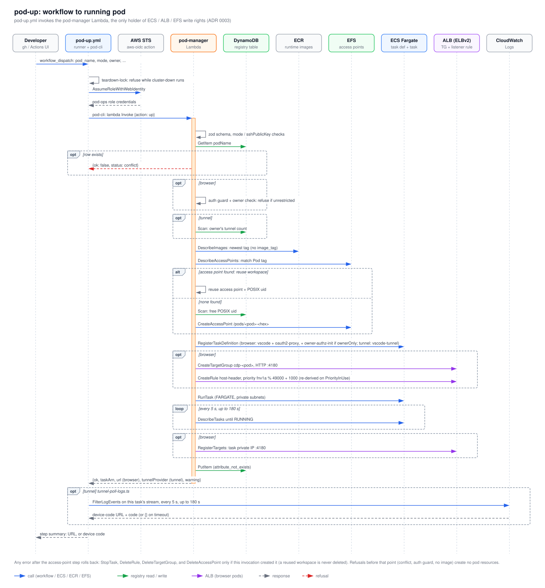

# pod-up sequence

This shows what happens between a developer dispatching `pod-up.yml` and the pod being reachable. It follows the code's order of calls in the pod-manager Lambda, the only component with ECS, ALB and EFS write rights. The idle reaper also writes the registry, to set and clear `idleSince`. Read it when you're debugging a failed `pod-up`, or before changing the pod-manager's up path.

## How to read it

- Each column is a participant. Dashed vertical lines are lifelines, and time runs downward.
- Blue arrows are calls to the workflow, ECR, EFS or ECS. Green arrows are registry (DynamoDB) reads and writes. Purple arrows are ALB calls, made for browser pods only.
- Dashed gray arrows are responses. The dashed red arrow is the conflict refusal.
- A small loop on one lifeline is work done inside that participant.
- `opt` frames run only when their condition holds. The `alt` frame picks one of two branches. The `loop` frame repeats.
- The orange bar on the pod-manager lifeline marks the Lambda invocation.

## Walkthrough

1. The developer dispatches [`pod-up.yml`](../../../.github/workflows/pod-up.yml) with `pod_name`, `mode` (`browser` or `tunnel`), sizing, `owner` and so on.
2. The workflow refuses to run while a `cluster-down` is queued or running (the `teardown-lock` action). It then assumes the pod-ops role through GitHub OIDC (the [`aws-oidc`](../../../.github/actions/aws-oidc/action.yml) action). The only Lambda that role can invoke is `pod-manager`.
3. [`pod-cli.ts`](../../../scripts/pod-cli.ts) sends a synchronous `lambda:Invoke` with `{action: "up", ...}`. When `owner` is empty, it uses `GITHUB_ACTOR`.
4. [`handler.ts`](../../../infra/lambda/pod-manager/handler.ts) validates the event with zod. [`actions.ts`](../../../infra/lambda/pod-manager/actions.ts) then checks how the mode pairs with `sshPublicKey`.
5. `GetItem` on the registry. If a row for `podName` already exists, pod-up stops with `conflict`. A registered pod is never reused or restarted.
6. Browser pods only: the auth guard refuses to launch when the active IdP has no sign-in restriction, and the owner check validates `owner` for `ownerOnly`. Tunnel pods only: a registry `Scan` counts the owner's tunnel pods and adds a warning at 10 or more.
7. When no `image_tag` was given, `DescribeImages` picks the newest tagged image in the browser or tunnel ECR repo. If there's no image, pod-up stops with an error.
8. Workspace reuse: `DescribeAccessPoints` looks for an available access point tagged `Pod=<podName>`. If one exists, its access point and POSIX uid are reused, and older duplicates are deleted (a side effect that happens even if pod-up later fails). Otherwise, a registry `Scan` finds a free uid in `[10000, 65000)`, and `CreateAccessPoint` makes `/pods/<pod>-<8 hex>` with mode `0700`. `checkWorkspaceOwner` also has dormant code for ADR 0009's central auth host, but it can't be turned on today: nothing in `infra/lib` sets `AUTH_BROWSER_CENTRAL_AUTH_HOST`.
9. `RegisterTaskDefinition`: browser tasks get the `vscode` container plus the oauth2-proxy sidecar (OAuth secret ARNs come from Secrets Manager `DescribeSecret`). With `auth.browser.ownerOnly`, they also get an `owner-authz-init` container and its volume. Tunnel tasks get a single `vscode-tunnel` container. Both mount the access point at `/workspace`.
10. Browser pods only: `CreateTargetGroup cdp-<pod>` (HTTP 4180, health check `/ping`). Then `CreateRule` on the shared listener with a `host-header` condition. The priority is `fnv1a(podName) % 49000 + 1000`, and on `PriorityInUse` it retries up to 5 times with `priority = (priority + 1) % 49000 + 1000`. That is roughly +1001, not the next number.
11. `RunTask` (FARGATE, private subnets, no public IP). `DescribeTasks` then polls every 5 s until the task is `RUNNING`, and fails after 180 s or if the task stops first.
12. Browser pods only: `RegisterTargets` adds the task's private IP on port 4180 to the target group.
13. `PutItem` writes the registry row, with `attribute_not_exists(podName)`. The Lambda returns `taskArn` for every mode, plus `url` (browser) or `tunnelProvider` (tunnel), and any warning.
14. Tunnel pods only: [`tunnel-poll-logs.ts`](../../../scripts/tunnel-poll-logs.ts) runs `FilterLogEvents` on the started task's own log stream every 5 s, for up to 180 s, and extracts the device-code URL and code. It prints `{}` if it times out.
15. The step summary shows the browser URL and OAuth redirect URI, or the device code to enter.

**Rollback:** any error thrown after the access-point step (from `RegisterTaskDefinition` onward) stops the task, deletes the rule and target group, and deletes the access point only if this invocation created it. A reused workspace is never deleted. Refusals before that point create no pod resources, though the duplicate cleanup in step 8 may already have run.

## Elements and sources

| Element | What it is | Source |
| --- | --- | --- |
| Developer | Dispatches the workflow | `.github/workflows/pod-up.yml:13` |
| pod-up.yml | Workflow job `up` (runner + pod-cli) | `.github/workflows/pod-up.yml:70` |
| AWS STS | OIDC role assumption via `aws-oidc` | `.github/actions/aws-oidc/action.yml:17` |
| pod-manager | Lambda `pod-manager`, dispatcher | `infra/lambda/pod-manager/handler.ts:62` |
| DynamoDB | Registry table `cloud-dev-pods-registry` | `infra/lib/stacks/pod-manager-stack.ts:40` |
| ECR | Runtime image repos | `infra/lambda/pod-manager/aws.ts:146` |
| EFS | Per-pod access points | `infra/lambda/pod-manager/aws.ts:169` |
| ECS Fargate | Task definition and task | `infra/lambda/pod-manager/aws.ts:296` |
| ALB (ELBv2) | Target group and listener rule | `infra/lambda/pod-manager/aws.ts:493` |
| CloudWatch Logs | Pod log group `/cloud-dev-pods/dev/pods` | `.github/workflows/pod-up.yml:172` |
| workflow_dispatch | Inputs `pod_name`, `mode`, `owner`, ... | `.github/workflows/pod-up.yml:14` |
| teardown-lock self-call | Refuse while cluster-down runs | `.github/workflows/pod-up.yml:84` |
| AssumeRoleWithWebIdentity / credentials | `role-to-assume: AWS_POD_OPS_ROLE_ARN` | `.github/workflows/pod-up.yml:98` |
| pod-cli lambda Invoke | `RequestResponse` invoke of `pod-manager` | `scripts/pod-cli.ts:121` |
| Pod-ops role may invoke only pod-manager | `lambda:InvokeFunction` on `function:pod-manager` | `infra/lib/stacks/bootstrap-stack.ts:132` |
| zod schema, mode / sshPublicKey checks | Event validation and pairing | `infra/lambda/pod-manager/handler.ts:65`, `infra/lambda/pod-manager/actions.ts:34` |
| GetItem podName | `registryGet` | `infra/lambda/pod-manager/actions.ts:49` |
| conflict refusal | Row exists, so return `conflict` | `infra/lambda/pod-manager/actions.ts:50` |
| auth guard + owner check | `assertBrowserAuthRestricted`, `validateOwnerAuthorization` | `infra/lambda/pod-manager/actions.ts:61`, `infra/lambda/pod-manager/auth-guard.ts:47` |
| Scan: owner's tunnel count | `tunnelCapWarning` (cap 10) | `infra/lambda/pod-manager/actions.ts:246` |
| DescribeImages | `resolveLatestImageTag` | `infra/lambda/pod-manager/actions.ts:79` |
| DescribeAccessPoints | `findExistingAccessPoint` (Pod tag, newest wins, older duplicates deleted) | `infra/lambda/pod-manager/aws.ts:214`, `infra/lambda/pod-manager/aws.ts:259` |
| reuse access point + POSIX uid | Reuse branch. The owner check is dormant (env var never set) | `infra/lambda/pod-manager/actions.ts:99`, `infra/lambda/pod-manager/env.ts:108` |
| Scan: free POSIX uid | `allocatePosixUid` | `infra/lambda/pod-manager/aws.ts:135` |
| CreateAccessPoint | `/pods/<pod>-<hex>`, mode 0700 | `infra/lambda/pod-manager/aws.ts:169` |
| RegisterTaskDefinition | Browser vs tunnel containers; `owner-authz-init` when `ownerOnly` | `infra/lambda/pod-manager/aws.ts:317`, `infra/lambda/pod-manager/aws.ts:373`, `infra/lambda/pod-manager/owner-authz.ts:252` |
| oauth2-proxy sidecar builder | `buildOauth2ProxyContainer` | `infra/lambda/pod-manager/oauth2-proxy.ts:124` |
| CreateTargetGroup | `cdp-<pod>`, HTTP 4180 | `infra/lambda/pod-manager/aws.ts:493` |
| CreateRule + priority | host-header; `PriorityInUse` re-derives the priority | `infra/lambda/pod-manager/aws.ts:518`, `infra/lambda/pod-manager/aws.ts:543`, `infra/lambda/pod-manager/priority.ts:13` |
| RunTask | FARGATE, private subnets | `infra/lambda/pod-manager/aws.ts:416` |
| DescribeTasks loop | `waitForTaskRunning` (5 s, 180 s) | `infra/lambda/pod-manager/aws.ts:478` |
| RegisterTargets | Task IP on 4180 | `infra/lambda/pod-manager/aws.ts:552` |
| PutItem | `registryPut`, `attribute_not_exists` | `infra/lambda/pod-manager/aws.ts:104` |
| Lambda response | `taskArn` always; `url` or `tunnelProvider` per mode | `infra/lambda/pod-manager/actions.ts:177`, `infra/lambda/pod-manager/actions.ts:183` |
| FilterLogEvents loop | Task's own stream, 5 s, 180 s | `scripts/tunnel-poll-logs.ts:94` |
| device-code response | `extractDeviceCode`, `{}` on timeout | `scripts/tunnel-poll-logs.ts:79` |
| step summary | `$GITHUB_STEP_SUMMARY` | `.github/workflows/pod-up.yml:192` |
| Rollback note | Gated by `createdNewAp` | `infra/lambda/pod-manager/actions.ts:194` |

## Related

- [Pod down and idle reaper](pod-down-and-idle-reaper.md)
- [Pod lifecycle states](pod-state-machine.md)
- [ADR 0003: pod-manager Lambda](../../adr/0003-pod-manager-lambda.md)
- [ADR 0004: EFS per-pod access point](../../adr/0004-efs-per-pod-access-point.md)
- [ADR 0005: host-based ALB routing](../../adr/0005-host-based-alb-routing.md)
- [Delivery modes](../../delivery-modes.md)

Regenerate: see [../README.md#regenerating](../README.md#regenerating).
