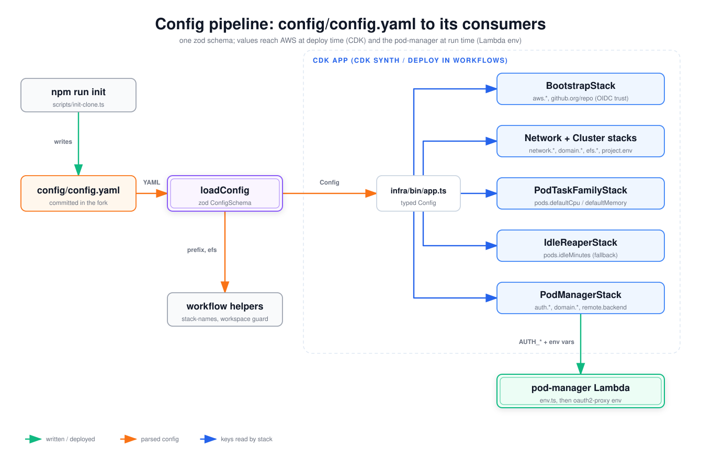

# Config pipeline: config/config.yaml to its consumers

How `config/config.yaml` is written, validated and consumed. Every reader goes through the same `loadConfig` and zod schema. CDK reads the result at deploy time and bakes values into stacks. The pod-manager Lambda sees config only through the environment variables `PodManagerStack` sets, so a config change reaches running pod-ups only after `cluster-up` redeploys. Read this to find out which key affects what, and what you have to redeploy after editing one.

## How to read it

- The large dashed box is the CDK app. Each blue box is a stack, and its second line lists the config keys that stack reads.
- Green arrows mean written or deployed. Orange arrows carry parsed config. Blue arrows mean "this stack reads these keys from the typed config".

## Walkthrough

1. **Write.** `npm run init` ([`init-clone.ts`](../../../scripts/init-clone.ts)) asks for account, region, domain strategy, browser and tunnel auth, VPC CIDR, pod sizing, idle minutes and workspace retention, then renders `config/config.yaml`. You can also write it by hand from [`config.example.yaml`](../../../config/config.example.yaml). Forks must commit it, because the workflows read it from the checkout.
2. **Load.** [`loadConfig`](../../../infra/lib/config/config.ts) picks the file (`CDPODS_CONFIG`, then `config/config.yaml`, then `config/config.example.yaml`) and parses the YAML.
3. **Validate and resolve.** [`resolveConfig`](../../../infra/lib/config/schema.ts) applies `ConfigSchema`: defaults (region `us-west-2`, CIDR `10.0.0.0/16`, 1024 CPU / 2048 MB, 60 idle minutes, `retainOnClusterDown: false`), provider rules (OIDC needs an https `issuerUrl`; Entra needs tenant GUIDs; GitHub-only keys are refused for other providers), `entra-id` / `oidc` requiring `domain.strategy: byo`, `remote.backend` rejected until a backend ships, and the deprecated `github.oauthAllowed*` keys mapped into `auth.browser`.
4. **CDK stacks** (synthesized by `bootstrap-aws`, `cluster-up` and `cluster-down` with `CDPODS_CONFIG` pointing at the committed file):
   - `BootstrapStack`: `aws.accountId` / `region`, and `github.org` / `repo` in the OIDC trust condition of the deployer roles. Also creates the ECR repos.
   - `NetworkStack` + `ClusterStack`: `network.vpcCidr`, `natGateways`, `useVpcEndpoints`; `domain.strategy`, `baseDomain`, `hostedZoneId` (hosted zone, wildcard certificate, HTTPS listener for `byo`); `efs.retainOnClusterDown` (EFS removal policy); `project.env` (log group names).
   - `PodTaskFamilyStack`: `pods.defaultCpu` / `defaultMemory`, but only on the placeholder revisions, which never run.
   - `IdleReaperStack`: `pods.idleMinutes` as `IDLE_MINUTES_DEFAULT`, used only for registry entries without their own idle value.
   - `PodManagerStack`: `domain.baseDomain` / `strategy`, `remote.backend`, and the whole resolved `auth` block through [`auth-env.ts`](../../../infra/lib/config/auth-env.ts) as `AUTH_BROWSER_*` / `AUTH_TUNNEL_PROVIDER` (lists JSON-encoded).
   - `naming.prefix` sets every stack name.
   - `project.name` and `project.env` build every SSM parameter path the stacks write (`/<name>/<env>/<key>`).
5. **Lambda.** [`env.ts`](../../../infra/lambda/pod-manager/env.ts) parses those variables once at cold start. The browser auth guard and the oauth2-proxy sidecar builder read `env.auth.browser`; tunnel pods default to `env.auth.tunnel.provider`.
6. **Workflow helpers.** [`stack-names.ts`](../../../scripts/stack-names.ts) reads `naming.prefix` so the workflows target the right stacks. [`cluster-workspace-guard.ts`](../../../scripts/cluster-workspace-guard.ts) reads `efs.retainOnClusterDown` to explain a refused `cluster-down`.

**Not from config.** The pod-up workflow's `cpu`, `memory` and `idle_minutes` inputs default to 1024, 2048 and 60 in the workflow file itself. They do not read `pods.defaultCpu`, `defaultMemory` or `idleMinutes`; a pod-up sends its own values to pod-manager. `pods.spotPercentage` is validated but nothing reads it. The workflows hardcode `/cloud-dev-pods/dev/...` SSM paths (cluster-up outputs, the bootstrap-aws role ARNs) and the `/cloud-dev-pods/dev/pods` log group (the pod-up tunnel poll). Any `project.name` other than `cloud-dev-pods` or `project.env` other than `dev` therefore breaks cluster-up, bootstrap-aws and the tunnel device-code poll. [`scripts/render-config.ts`](../../../scripts/render-config.ts) is an empty stub; no workflow calls it.

## Elements and sources

| Element | What it is | Source |
| --- | --- | --- |
| npm run init | Interactive init that renders the YAML | `scripts/init-clone.ts:687`, `scripts/init-clone.ts:1221` |
| config/config.yaml | Committed fork config | `scripts/init-clone.ts:46` |
| loadConfig | File resolution and YAML parse | `infra/lib/config/config.ts:21` |
| zod ConfigSchema | Schema, defaults and cross-field rules | `infra/lib/config/schema.ts:160`, `infra/lib/config/schema.ts:234` |
| infra/bin/app.ts | CDK entry, loads config | `infra/bin/app.ts:11` |
| CDK app box | Stack wiring, names from `naming.prefix` | `infra/lib/app.ts:27` |
| BootstrapStack | Reads `github.org` / `repo` for the OIDC trust | `infra/lib/stacks/bootstrap-stack.ts:84` |
| Network + Cluster stacks | Read `network.*`, `domain.*`, `efs.retainOnClusterDown`, `project.env` | `infra/lib/stacks/network-stack.ts:41`, `infra/lib/stacks/cluster-stack.ts:99`, `infra/lib/stacks/cluster-stack.ts:119`, `infra/lib/stacks/cluster-stack.ts:176` |
| PodTaskFamilyStack | Reads `pods.defaultCpu` / `defaultMemory` | `infra/lib/stacks/pod-task-family-stack.ts:160` |
| IdleReaperStack | `IDLE_MINUTES_DEFAULT` from `pods.idleMinutes` | `infra/lib/stacks/idle-reaper-stack.ts:67` |
| PodManagerStack | Lambda environment from config | `infra/lib/stacks/pod-manager-stack.ts:88`, `infra/lib/stacks/pod-manager-stack.ts:93` |
| pod-manager Lambda | Parses the environment | `infra/lambda/pod-manager/env.ts:48` |
| workflow helpers | `naming.prefix` and `efs.retainOnClusterDown` readers | `scripts/stack-names.ts:104`, `scripts/cluster-workspace-guard.ts:351` |
| Edge: writes | `writeFileSync(CONFIG_PATH, renderConfigYaml(a))` | `scripts/init-clone.ts:1222` |
| Edge: YAML | `readFileSync` + `parseYaml` | `infra/lib/config/config.ts:23` |
| Edge: Config | `resolveConfig(parsed)` returns typed config | `infra/lib/config/config.ts:25` |
| Edge: prefix, efs | Helpers import `loadConfig` | `scripts/stack-names.ts:42`, `scripts/cluster-workspace-guard.ts:351` |
| Edges: app to stacks | Each stack receives `config` | `infra/lib/app.ts:31`, `infra/lib/app.ts:35`, `infra/lib/app.ts:39`, `infra/lib/app.ts:43`, `infra/lib/app.ts:47`, `infra/lib/app.ts:53` |
| Edge: AUTH_* + env vars | `authLambdaEnvironment(config)` merged into the Lambda environment | `infra/lib/config/auth-env.ts:9`, `infra/lib/stacks/pod-manager-stack.ts:100` |
| SSM path from project.name / env (walkthrough) | `ssmParamPath` builds `/<name>/<env>/<key>`; workflows hardcode `/cloud-dev-pods/dev/...` | `infra/lib/util/naming.ts:8`, `.github/workflows/cluster-up.yml:113`, `.github/workflows/bootstrap-aws.yml:98`, `.github/workflows/pod-up.yml:172` |
| CDPODS_CONFIG in workflows (walkthrough) | cdk deploy points at the committed file | `.github/workflows/cluster-up.yml:100`, `.github/workflows/bootstrap-aws.yml:68` |
| pod-up sizing inputs (walkthrough) | Workflow-level defaults, not config | `.github/workflows/pod-up.yml:27` |
| spotPercentage (walkthrough) | Validated, unused | `infra/lib/config/schema.ts:202` |
| render-config stub (walkthrough) | `export {}` only | `scripts/render-config.ts:8` |

## Related

- [Browser pod anatomy](pod-task-anatomy-browser.md)
- [Tunnel pod anatomy](pod-task-anatomy-tunnel.md)
- [Runtime image build](runtime-image-build.md)
- [ADR 0007: EFS cluster removal policy](../../adr/0007-efs-cluster-removal-policy.md)
- [ADR 0008: pluggable browser IdP](../../adr/0008-pluggable-browser-idp.md)
- [Choosing auth and access](../../choosing-auth-and-access.md)
- [Extending](../../extending.md)

Regenerate: see [../README.md#regenerating](../README.md#regenerating).
