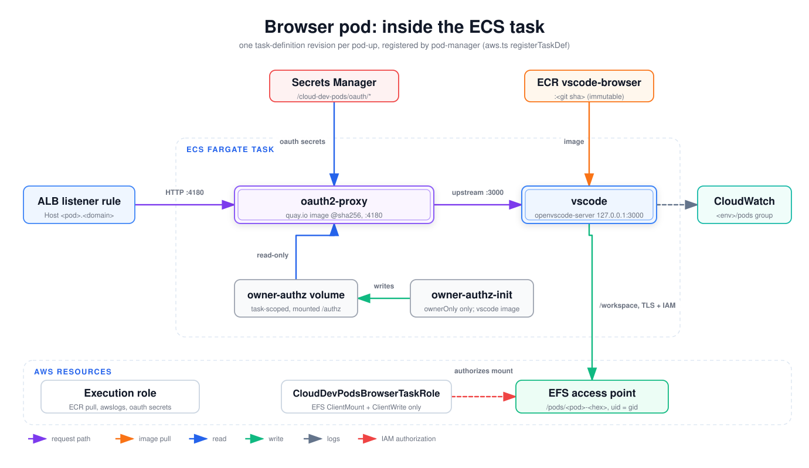

# Browser pod: inside the ECS task

What runs inside one browser-mode pod: the containers, the volumes, and the AWS resources the task touches. Every runnable revision is registered by the pod-manager Lambda at pod-up, not by CDK; the CDK revision in `PodTaskFamilyStack` is a placeholder that never runs. Read this when debugging a browser pod that won't start, won't authenticate, or can't reach its workspace.

## How to read it

- The dashed box in the middle is one Fargate task. Boxes inside it are containers or task volumes. Boxes outside it are what the task pulls from or writes to.
- Purple arrows are the user's HTTP request path. Orange arrows are image pulls at task start. Blue arrows are reads, green arrows are writes.
- The dashed grey arrow is log shipping (the `awslogs` driver). Every container in the task logs to the same group; only one arrow is drawn.
- The dashed red arrow is IAM authorization, not traffic.
- Double-bordered boxes are the two essential long-running containers.

## Walkthrough

1. **Images.** The `vscode` container runs the immutable `<repo URI>:<git sha>` image from ECR, resolved by pod-manager (see [runtime-image-build](runtime-image-build.md)). The `oauth2-proxy` sidecar runs a public quay.io image pinned by digest, `v7.15.5` (shown in the node text rather than as a separate box), in [`oauth2-proxy.ts`](../../../infra/lambda/pod-manager/oauth2-proxy.ts). The execution role pulls the images, writes logs, and resolves the oauth secrets.
2. **Request path.** The cluster ALB has a per-pod listener rule (`Host: <pod>.<domain>`) and an IP target group on port 4180. Only the sidecar listens on the task ENI (`0.0.0.0:4180`). After sign-in it reverse-proxies to `http://127.0.0.1:3000`. openvscode-server is bound to loopback ([`entrypoint.sh`](../../../runtime/vscode-browser/entrypoint.sh)), so nothing reaches VS Code without passing the proxy. The tasks security group admits only the ALB on 4180.
3. **Start order and health.** `vscode` has an ECS health check (`curl -fsS http://127.0.0.1:3000/`, 30 s interval, 20 s start period). The sidecar `dependsOn` `vscode` being `HEALTHY`.
4. **Secrets.** The sidecar gets `OAUTH2_PROXY_CLIENT_ID`, `_CLIENT_SECRET` and `_COOKIE_SECRET` from Secrets Manager (`/cloud-dev-pods/oauth/*`) through ECS `secrets`. Provider settings (GitHub, Entra ID, OIDC) come from the Lambda's `AUTH_*` environment (see [config-pipeline](config-pipeline.md)).
5. **Owner-only (optional).** With `auth.browser.ownerOnly: true`, pod-manager adds a non-essential `owner-authz-init` container, run as root from the vscode image, and a task-scoped volume. The init container writes a per-task random cookie secret (and, for `oidc` / `entra-id`, an allowed-emails file) to `/authz`, then exits. The sidecar mounts `/authz` read-only, waits for the init container's `SUCCESS`, and drops the shared cookie secret. The `vscode` container does not mount this volume.
6. **Workspace.** The `workspace` volume is the cluster EFS file system mounted at `/workspace` with transit encryption and IAM authorization through the pod's access point. The access point root is `/pods/<pod>-<8 hex>`, created `0700` and owned by an allocated POSIX uid (`uid = gid`, in `[10000, 65000)`). The file-system policy denies any mount without TLS or without an access point.
7. **Roles.** `CloudDevPodsBrowserTaskRole` grants only `elasticfilesystem:ClientMount` and `ClientWrite`, through a mount target and an access point. It has no CloudWatch Logs actions. The shared `CloudDevPodsTaskExecutionRole` carries `AmazonECSTaskExecutionRolePolicy` plus read on the three oauth secrets.
8. **Network.** The task runs in the private subnets with `assignPublicIp: DISABLED` and ECS Exec off.

## Elements and sources

| Element | What it is | Source |
| --- | --- | --- |
| ALB listener rule | Per-pod host rule and IP target group on port 4180 | `infra/lambda/pod-manager/aws.ts:493`, `infra/lambda/pod-manager/aws.ts:518` |
| Secrets Manager | `/cloud-dev-pods/oauth/{client-id,client-secret,cookie-secret}` ARNs resolved per pod-up | `infra/lambda/pod-manager/aws.ts:334` |
| ECR vscode-browser | Image `<repo URI>:<tag>` chosen by pod-manager | `infra/lambda/pod-manager/actions.ts:87` |
| oauth2-proxy | Essential sidecar, `0.0.0.0:4180`, upstream `127.0.0.1:3000` | `infra/lambda/pod-manager/oauth2-proxy.ts:130` |
| vscode | Essential container, port 3000, health check, `/workspace` mount | `infra/lambda/pod-manager/aws.ts:318` |
| owner-authz volume | Task-scoped volume mounted at `/authz` | `infra/lambda/pod-manager/owner-authz.ts:192` |
| owner-authz-init | Non-essential init container, root, vscode image | `infra/lambda/pod-manager/owner-authz.ts:193` |
| CloudWatch | Pods log group `/cloud-dev-pods/<env>/pods`, two-week retention | `infra/lib/stacks/cluster-stack.ts:175` |
| Execution role | `CloudDevPodsTaskExecutionRole`: image pull, logs, oauth secrets | `infra/lib/stacks/pod-task-family-stack.ts:74` |
| CloudDevPodsBrowserTaskRole | Task role, EFS ClientMount + ClientWrite only | `infra/lib/stacks/pod-task-family-stack.ts:111` |
| EFS access point | Per-pod access point, POSIX uid, `0700` root `/pods/<pod>-<hex>` | `infra/lambda/pod-manager/aws.ts:169` |
| ECS Fargate task | Per-pod revision: awsvpc, Fargate, X86_64, private subnets | `infra/lambda/pod-manager/aws.ts:390`, `infra/lambda/pod-manager/aws.ts:423` |
| Edge: HTTP :4180 | ALB forwards to the sidecar; tasks SG admits only the ALB on 4180 | `infra/lib/stacks/network-stack.ts:87` |
| Edge: upstream :3000 | `OAUTH2_PROXY_UPSTREAMS=http://127.0.0.1:3000`; VS Code bound to loopback | `infra/lambda/pod-manager/oauth2-proxy.ts:146`, `runtime/vscode-browser/entrypoint.sh:5` |
| Sidecar image (in node text) | `quay.io/oauth2-proxy/oauth2-proxy@sha256:...`, v7.15.5, public, pinned by digest | `infra/lambda/pod-manager/oauth2-proxy.ts:12`, `infra/lambda/pod-manager/oauth2-proxy.ts:132` |
| Edge: image (ECR) | `vscode` image; also the init container's image | `infra/lambda/pod-manager/aws.ts:320`, `infra/lambda/pod-manager/aws.ts:343` |
| Edge: oauth secrets | ECS `secrets` on the sidecar | `infra/lambda/pod-manager/oauth2-proxy.ts:152` |
| Edge: logs | `awslogs` driver, stream prefix `browser/<pod>/<container>` | `infra/lambda/pod-manager/aws.ts:308` |
| Edge: writes | Init script writes the cookie secret and emails file | `infra/lambda/pod-manager/owner-authz.ts:156` |
| Edge: read-only | Sidecar mounts `/authz` read-only, waits for init `SUCCESS` | `infra/lambda/pod-manager/owner-authz.ts:189` |
| Edge: /workspace, TLS + IAM | EFS volume with `transitEncryption` and `authorizationConfig` | `infra/lambda/pod-manager/aws.ts:398` |
| Edge: authorizes mount | Task-role policy plus deny-without-TLS / deny-without-access-point file-system policy | `infra/lib/stacks/pod-task-family-stack.ts:98`, `infra/lib/stacks/cluster-stack.ts:73` |
| Health check (in node text) | `curl -fsS http://127.0.0.1:3000/`; sidecar waits for `HEALTHY` | `infra/lambda/pod-manager/aws.ts:325`, `infra/lambda/pod-manager/oauth2-proxy.ts:157` |

## Related

- [Tunnel pod anatomy](pod-task-anatomy-tunnel.md)
- [Runtime image build](runtime-image-build.md)
- [Config pipeline](config-pipeline.md)
- [ADR 0002: oauth2-proxy sidecar](../../adr/0002-oauth2-proxy-sidecar.md)
- [ADR 0004: EFS per-pod access point](../../adr/0004-efs-per-pod-access-point.md)
- [ADR 0005: host-based ALB routing](../../adr/0005-host-based-alb-routing.md)
- [ADR 0008: pluggable browser IdP](../../adr/0008-pluggable-browser-idp.md)
- [Delivery modes](../../delivery-modes.md)

Regenerate: see [../README.md#regenerating](../README.md#regenerating).
