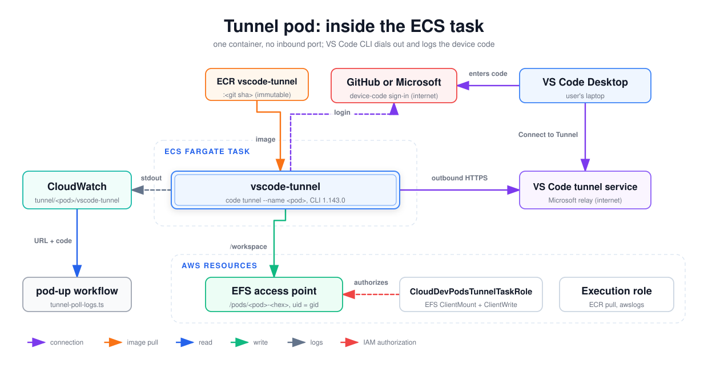

# Tunnel pod: inside the ECS task

What runs inside one tunnel-mode pod and what it talks to. A tunnel task has a single container running the pinned VS Code CLI. It has no inbound port, no ALB target and no sidecar: it dials out to the VS Code tunnel service, and the user signs in with a device code that the pod-up workflow picks out of CloudWatch Logs. Read this when a tunnel pod doesn't appear in VS Code Desktop or the device code never shows up.

## How to read it

- The small dashed box is the Fargate task. Boxes in the AWS row are resources in the account. The pod-up workflow runs in GitHub Actions. The GitHub/Microsoft, VS Code Desktop and tunnel service boxes are outside the VPC.
- Purple arrows are connections. The dashed purple arrow is the CLI's device-code sign-in, which completes only after the user enters the code.
- Orange is the image pull, green is the workspace write, blue is a read, dashed grey is log shipping, dashed red is IAM authorization.

## Walkthrough

1. **Image.** The `vscode-tunnel` container runs `<repo URI>:<git sha>` from the `cloud-dev-pods/vscode-tunnel` ECR repo. The image is `ubuntu:26.04` plus the VS Code CLI pinned to `1.143.0`, commit `2d0b7506a36c1d6db9a466440131a8e01eab2289`, verified by sha256 at build time (see [runtime-image-build](runtime-image-build.md)).
2. **Container contract.** pod-manager registers one essential container named `vscode-tunnel` with `POD_NAME` and `TUNNEL_PROVIDER` (`github` or `microsoft`) in its environment and a 30 s `stopTimeout`. The task definition has no port mappings and no ECS health check; the Dockerfile's `HEALTHCHECK` (`pgrep -x code`) only matters for local `docker run`.
3. **Sign-in.** The [entrypoint](../../../runtime/vscode-tunnel/entrypoint.sh) runs `code tunnel user login --provider $TUNNEL_PROVIDER` unless a login is already stored. The CLI prints the device-code prompt to stdout, which the `awslogs` driver ships to the pods log group under `tunnel/<pod>/vscode-tunnel`.
4. **Code surfacing.** The pod-up workflow runs [`tunnel-poll-logs.ts`](../../../scripts/tunnel-poll-logs.ts), which runs `FilterLogEvents` on that stream for the GitHub or Microsoft device URL and code, and prints them in the run summary. The user enters the code at `github.com/login/device` or `login.microsoft.com/device` from their laptop.
5. **Tunnel.** The entrypoint then runs `code tunnel --accept-server-license-terms --name <pod>`. The connection is outbound HTTPS only, from a private subnet through the NAT gateway (`assignPublicIp: DISABLED`). The user connects from VS Code Desktop with **Remote Tunnels: Connect to Tunnel**, signed in with the same account.
6. **Shutdown.** On SIGTERM (pod-down) the entrypoint stops the tunnel, then runs `code tunnel unregister` (bounded to fit the 30 s `stopTimeout`) to free the account's tunnel slot.
7. **Workspace and roles.** Same as browser pods: EFS at `/workspace` through the pod's access point with TLS and IAM, authorized by `CloudDevPodsTunnelTaskRole` (EFS ClientMount + ClientWrite only). The shared execution role pulls the image and writes logs.

**Not drawn: ssh mode.** The same image also serves `POD_MODE=ssh` (sshd on port 2222, its own task family, task role and execution role, an ECS health check `pgrep -x sshd`). pod-manager can register that task definition, but it can't launch today: the config schema rejects every `remote.backend` value, and pod-up only offers `browser` and `tunnel`.

## Elements and sources

| Element | What it is | Source |
| --- | --- | --- |
| ECR vscode-tunnel | Tunnel image repo; ssh pods reuse it | `infra/lambda/pod-manager/actions.ts:77` |
| vscode-tunnel | Single essential container, no ports, `stopTimeout: 30` | `infra/lambda/pod-manager/aws.ts:374` |
| ECS Fargate task | Per-pod revision in family `cloud-dev-pods-tunnel` | `infra/lambda/pod-manager/aws.ts:389`, `infra/lib/stacks/pod-task-family-stack.ts:195` |
| CloudWatch | Pods log group, stream prefix `tunnel/<pod>/vscode-tunnel` | `infra/lambda/pod-manager/aws.ts:379` |
| pod-up workflow | Polls the logs for the device code and prints it | `.github/workflows/pod-up.yml:163` |
| GitHub or Microsoft | Device-code identity provider, chosen by `TUNNEL_PROVIDER` | `runtime/vscode-tunnel/entrypoint.sh:109` |
| VS Code Desktop | User's local editor | `docs/delivery-modes.md:22` (VS Code product behavior, not repo code) |
| VS Code tunnel service | Microsoft relay the CLI registers the tunnel with | `runtime/vscode-tunnel/Dockerfile:1` |
| EFS access point | Per-pod access point, POSIX uid | `infra/lambda/pod-manager/aws.ts:169` |
| CloudDevPodsTunnelTaskRole | Task role, EFS ClientMount + ClientWrite only | `infra/lib/stacks/pod-task-family-stack.ts:118` |
| Execution role | Shared `CloudDevPodsTaskExecutionRole` | `infra/lambda/pod-manager/aws.ts:304` |
| Edge: image | Container `image` is the resolved ECR URI | `infra/lambda/pod-manager/aws.ts:376` |
| Edge: stdout | `awslogs` driver ships the login prompt | `runtime/vscode-tunnel/entrypoint.sh:121` |
| Edge: URL + code | `FilterLogEvents` with the device-URL pattern | `scripts/tunnel-poll-logs.ts:96` |
| Edge: login | `code tunnel user login --provider` | `runtime/vscode-tunnel/entrypoint.sh:122` |
| Edge: enters code | User completes the device flow on their laptop | `.github/workflows/pod-up.yml:189` |
| Edge: outbound HTTPS | `code tunnel --name <pod>` from a private subnet, no public IP | `runtime/vscode-tunnel/entrypoint.sh:153`, `infra/lambda/pod-manager/aws.ts:425` |
| Edge: Connect to Tunnel | Remote Tunnels connection from VS Code Desktop | `docs/delivery-modes.md:54` (product behavior) |
| Edge: /workspace | EFS volume with TLS and access-point IAM auth | `infra/lambda/pod-manager/aws.ts:398` |
| Edge: authorizes | Task-role EFS policy | `infra/lib/stacks/pod-task-family-stack.ts:98` |
| CLI pin (in node text) | Version, commit and sha256 build args | `runtime/vscode-tunnel/Dockerfile:11` |
| Unregister on SIGTERM (walkthrough) | Trap stops the tunnel, then unregisters it | `runtime/vscode-tunnel/entrypoint.sh:132` |
| ssh mode (walkthrough, not drawn) | ssh container definition; schema rejects every backend | `infra/lambda/pod-manager/aws.ts:348`, `infra/lib/config/schema.ts:139` |

## Related

- [Browser pod anatomy](pod-task-anatomy-browser.md)
- [Runtime image build](runtime-image-build.md)
- [Config pipeline](config-pipeline.md)
- [ADR 0004: EFS per-pod access point](../../adr/0004-efs-per-pod-access-point.md)
- [Delivery modes](../../delivery-modes.md)

Regenerate: see [../README.md#regenerating](../README.md#regenerating).
