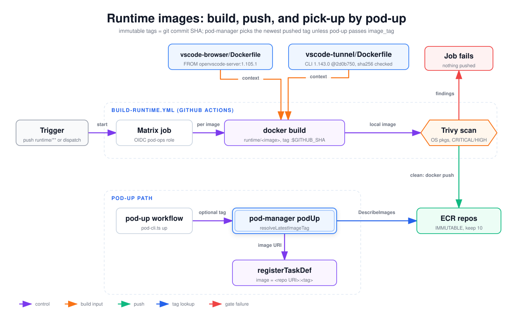

# Runtime images: build, push, and pick-up by pod-up

How the two runtime images get from `runtime/` into ECR, and how a pod-up turns "latest" into a concrete image URI in the task definition. Tags are the git commit SHA and the repos are immutable, so there is no moving `latest` tag. pod-manager picks the most recently pushed tag. Read this when a pod runs an unexpected image or pod-up says no image was found.

## How to read it

- The top dashed box is the `build-runtime.yml` job. The lower dashed box is the pod-up path (workflow plus pod-manager Lambda).
- Purple arrows are control flow. Orange arrows are build inputs (Docker build contexts). Green is the push, blue is the tag lookup, red is the failure exit.
- The hexagon is the gate: a Trivy finding fails the job before anything is pushed.

## Walkthrough

1. **Trigger.** A push to `main` touching `runtime/**` or the workflow file, or a manual dispatch with `image` = `all`, `vscode-browser` or `vscode-tunnel`. A guard job turns the choice into a matrix and skips upstream (`foolswithtools/cloud-dev-pods`).
2. **Matrix job.** One job per image, authenticated to AWS through OIDC with `AWS_POD_OPS_ROLE_ARN`, then `docker login` to the account's ECR registry.
3. **Build.** `docker build runtime/<image>` tagged `<account>.dkr.ecr.<region>.amazonaws.com/cloud-dev-pods/<image>:$GITHUB_SHA`. The two contexts:
   - [`runtime/vscode-browser/Dockerfile`](../../../runtime/vscode-browser/Dockerfile): `FROM gitpod/openvscode-server:1.105.1`, apt upgrade plus git/build tools, pre-seeded machine settings, and an entrypoint binding openvscode-server to `127.0.0.1:3000`.
   - [`runtime/vscode-tunnel/Dockerfile`](../../../runtime/vscode-tunnel/Dockerfile): `FROM ubuntu:26.04`, a `vscode` user with passwordless sudo, openssh-server (for ssh mode), and the VS Code CLI pinned by build args: version `1.143.0`, commit `2d0b7506a36c1d6db9a466440131a8e01eab2289`, sha256 `efd89d72d5ef9a24bd0dcc2353df902a92650e8665f856527fc538c18eab23e9`. The build fails if the download's sha256 or `code --version` output doesn't match. The workflow prints the CLI version from the built image into the run summary.
4. **Scan.** Trivy 0.70.0 scans OS packages for fixed CRITICAL/HIGH findings with `--exit-code 1`. A finding fails the job, so nothing is pushed.
5. **Push.** `docker push` to `cloud-dev-pods/vscode-browser` or `cloud-dev-pods/vscode-tunnel`. The repos are created by `BootstrapStack` with `IMMUTABLE` tags, scan-on-push, and a lifecycle rule keeping the last 10 images.
6. **Pick-up.** The pod-up workflow calls `scripts/pod-cli.ts up`, passing `--image-tag` only when the `image_tag` input is set. pod-manager uses that tag, or else `resolveLatestImageTag`: `DescribeImages` on the repo, newest `imagePushedAt` with a tag. Browser pods use the browser repo; tunnel (and ssh) pods use the tunnel repo. No image means pod-up fails with "Run build-runtime workflow first."
7. **Task definition.** `registerTaskDef` puts `image = <repo URI>:<tag>` on the main container (and on the owner-only init container for browser pods). The CDK task definitions use the placeholder tag `replaced-by-pod-manager` and never run.

**Not drawn:** `runtime/shared/install-tools.sh` and `runtime/shared/healthcheck.sh` exist but no Dockerfile or workflow references them. The images install their tools inline, and health checks come from the Dockerfiles and the task definitions.

## Elements and sources

| Element | What it is | Source |
| --- | --- | --- |
| Trigger | `workflow_dispatch` image choice, or push to `main` on `runtime/**` | `.github/workflows/build-runtime.yml:9` |
| Matrix job | Per-image job, OIDC with the pod-ops role | `.github/workflows/build-runtime.yml:45`, `.github/workflows/build-runtime.yml:62` |
| vscode-browser/Dockerfile | openvscode-server 1.105.1 base | `runtime/vscode-browser/Dockerfile:4` |
| vscode-tunnel/Dockerfile | ubuntu:26.04 plus pinned VS Code CLI | `runtime/vscode-tunnel/Dockerfile:6`, `runtime/vscode-tunnel/Dockerfile:11` |
| docker build | Build tagged with `$GITHUB_SHA` | `.github/workflows/build-runtime.yml:80` |
| Trivy scan | OS packages, CRITICAL/HIGH, ignore unfixed, exit 1 | `.github/workflows/build-runtime.yml:99` |
| Job fails | Non-zero Trivy exit stops the job before push | `.github/workflows/build-runtime.yml:112` |
| ECR repos | IMMUTABLE, scan on push, keep last 10 | `infra/lib/stacks/bootstrap-stack.ts:171` |
| pod-up workflow | `pod-cli.ts up` with optional `--image-tag` | `.github/workflows/pod-up.yml:114`, `.github/workflows/pod-up.yml:127` |
| pod-manager podUp | Chooses repo by mode, resolves tag | `infra/lambda/pod-manager/actions.ts:77` |
| registerTaskDef | Registers the per-pod revision with the image URI | `infra/lambda/pod-manager/aws.ts:296` |
| Edge: start | Guard job emits the image matrix | `.github/workflows/build-runtime.yml:35` |
| Edge: per image | `strategy.matrix.image` | `.github/workflows/build-runtime.yml:51` |
| Edge: context (browser, tunnel) | Build context `runtime/${IMAGE}` | `.github/workflows/build-runtime.yml:85` |
| Edge: local image | Scan runs on the locally built `$IMAGE_URI` | `.github/workflows/build-runtime.yml:113` |
| Edge: findings | `--exit-code 1` | `.github/workflows/build-runtime.yml:112` |
| Edge: clean, docker push | Push step | `.github/workflows/build-runtime.yml:115` |
| Edge: optional tag | `e.imageTag` wins over the lookup | `infra/lambda/pod-manager/actions.ts:79` |
| Edge: DescribeImages | `resolveLatestImageTag`, newest pushed tagged image | `infra/lambda/pod-manager/aws.ts:146` |
| Edge: image URI | `imageUri = <repoUri>:<resolvedTag>` passed to `registerTaskDef` | `infra/lambda/pod-manager/actions.ts:87`, `infra/lambda/pod-manager/actions.ts:132` |
| CLI version in summary (walkthrough) | `docker run ... code --version` | `.github/workflows/build-runtime.yml:88` |
| Placeholder tag (walkthrough) | CDK revisions use `replaced-by-pod-manager` | `infra/lib/stacks/pod-task-family-stack.ts:173` |

## Related

- [Browser pod anatomy](pod-task-anatomy-browser.md)
- [Tunnel pod anatomy](pod-task-anatomy-tunnel.md)
- [Config pipeline](config-pipeline.md)
- [ADR 0003: pod-manager Lambda](../../adr/0003-pod-manager-lambda.md)
- [Maintainer runbook (bumping the tunnel CLI pin)](../../maintainer-runbook.md)

Regenerate: see [../README.md#regenerating](../README.md#regenerating).
