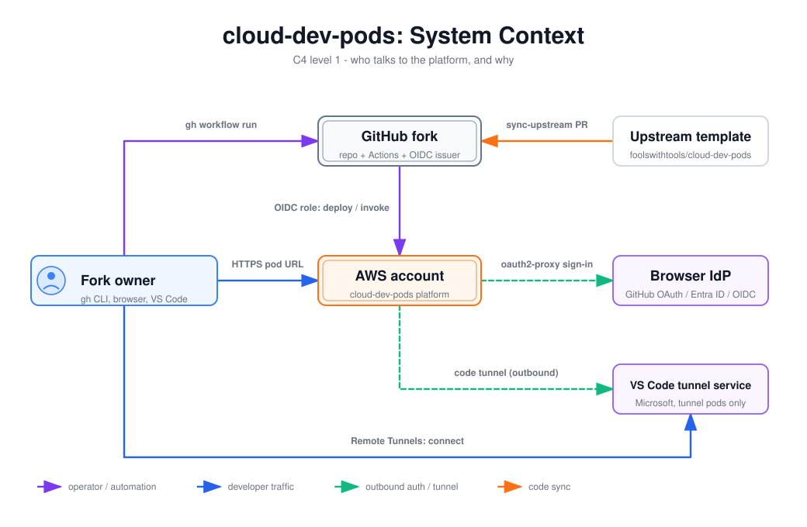

# cloud-dev-pods: System Context

C4 level-1 view of cloud-dev-pods. It shows the fork owner, the GitHub fork that runs every provisioning workflow, the AWS account that hosts the platform, and the outside services the pods depend on. Read this first. It tells you which party starts each interaction and why, before you open the infrastructure, auth or pod-lifecycle diagrams.

## How to read it

- **Purple solid**: operator or automation calls. The fork owner dispatches workflows, and GitHub Actions assumes an AWS role through OIDC.
- **Blue solid**: developer traffic. A browser opens a pod URL, or VS Code Desktop connects to a tunnel.
- **Green dashed**: outbound calls from inside the AWS account to identity or tunnel providers. The pod opens the connection, so no inbound port is involved.
- **Orange**: code sync from the upstream template into the fork.
- Double-bordered boxes are systems this project owns or configures (the fork and the AWS account). Single-bordered boxes are external systems.

## Walkthrough

1. **Fork owner to GitHub fork (`gh workflow run`).** Every provisioning and pod operation is a `workflow_dispatch` workflow in the fork, for example [`pod-up.yml`](../../../.github/workflows/pod-up.yml). That keeps an audit trail in GitHub Actions.
2. **GitHub fork to AWS account (OIDC role).** Workflows request an OIDC token (`id-token: write`) and assume `CloudDevPodsDeployerRole` (cluster-up/down) or `CloudDevPodsPodOpsRole` (pod-up/down/list, build-runtime). The roles trust `token.actions.githubusercontent.com`, limited to the fork's `main` branch or `prod` environment ([`bootstrap-stack.ts`](../../../infra/lib/stacks/bootstrap-stack.ts)). The deployer role runs `cdk deploy`. The pod-ops role invokes the `pod-manager` Lambda and pushes runtime images. `bootstrap-aws.yml` is the exception: it has no OIDC path and always uses the static `AWS_BOOTSTRAP_*` keys (`.github/workflows/bootstrap-aws.yml:48-53`), so it fails if re-run after `npm run init -- --post-bootstrap` has deleted them.
3. **Upstream template to GitHub fork (sync-upstream PR).** [`sync-upstream.yml`](../../../.github/workflows/sync-upstream.yml) runs on a schedule or on demand. It fetches `foolswithtools/cloud-dev-pods@main` and opens a PR in the fork.
4. **Fork owner to AWS account (HTTPS pod URL).** Browser-mode pods are reached at `https://<pod>.<base-domain>` through the ALB (HTTP only when `domain.strategy` is `alb-default`).
5. **AWS account to browser IdP (oauth2-proxy sign-in).** Each browser pod runs an oauth2-proxy sidecar configured for GitHub, Entra ID or generic OIDC ([`oauth2-proxy.ts`](../../../infra/lambda/pod-manager/oauth2-proxy.ts)). The user's browser is redirected to the IdP to sign in. oauth2-proxy then redeems the code with the IdP server-side.
6. **AWS account to VS Code tunnel service (outbound).** Tunnel-mode pods run `code tunnel` ([`entrypoint.sh`](../../../runtime/vscode-tunnel/entrypoint.sh)). The pod registers with Microsoft's tunnel service after a GitHub or Microsoft device-code login.
7. **Fork owner to VS Code tunnel service (connect).** The fork owner connects from local VS Code Desktop with "Remote Tunnels: Connect to Tunnel", signed in with the same account.

## Elements and sources

| Element | What it is | Source |
| --- | --- | --- |
| Fork owner | Person who owns the fork, runs `gh`, and uses the pods | `CLAUDE.md` (user mode) |
| GitHub fork | Fork repo, its Actions workflows, and the Actions OIDC token issuer | `.github/workflows/pod-up.yml:74` (`id-token: write`) |
| Upstream template | `foolswithtools/cloud-dev-pods`, source of tracked files | `.github/workflows/sync-upstream.yml:59` |
| AWS account | Everything the CDK app deploys (see the infrastructure diagrams) | `infra/lib/app.ts:21` |
| Browser IdP | GitHub OAuth, Entra ID, or a generic OIDC provider | `infra/lib/config/schema.ts:9` |
| VS Code tunnel service | Microsoft-hosted relay used by tunnel pods | `runtime/vscode-tunnel/entrypoint.sh:153` |
| Edge: gh workflow run | Owner dispatches workflows | `.github/workflows/pod-up.yml:14` |
| Edge: OIDC role, deploy / invoke | OIDC trust plus the deployer and pod-ops roles | `infra/lib/stacks/bootstrap-stack.ts:35`, `infra/lib/stacks/bootstrap-stack.ts:83`, `infra/lib/stacks/bootstrap-stack.ts:130` |
| Edge: sync-upstream PR | Scheduled or manual upstream sync PR | `.github/workflows/sync-upstream.yml:118` |
| Edge: HTTPS pod URL | Host-based ALB listener (HTTPS for `byo`) | `infra/lib/stacks/cluster-stack.ts:146` |
| Edge: oauth2-proxy sign-in | Provider-specific oauth2-proxy settings | `infra/lambda/pod-manager/oauth2-proxy.ts:47` |
| Edge: code tunnel (outbound) | Device-code login, then tunnel registration | `runtime/vscode-tunnel/entrypoint.sh:122`, `runtime/vscode-tunnel/entrypoint.sh:153` |
| Edge: Remote Tunnels connect | Local VS Code Desktop attaches to the named tunnel | `docs/delivery-modes.md` |

Not drawn: the redirect from the user's browser to the IdP login page (it goes through the browser, not the platform), and the SSH delivery mode, which is hidden until a remote-access backend ships (`.github/workflows/pod-up.yml:5`).

## Related

- [AWS deployment topology](../infrastructure/aws-deployment-topology.md)
- [CDK stack composition](../infrastructure/cdk-stack-composition.md)
- [Architecture overview](../../architecture.md)
- [Delivery modes](../../delivery-modes.md)
- [Choosing auth and access](../../choosing-auth-and-access.md)
- [ADR 0003: pod-manager Lambda](../../adr/0003-pod-manager-lambda.md)
- [ADR 0008: pluggable browser IdP](../../adr/0008-pluggable-browser-idp.md)

Regenerate: see [../README.md#regenerating](../README.md#regenerating).
